# Woche 2: Unity und der erste XR-Prototyp

## Überblick

In der zweiten Woche wird das erste eigene XR-Projekt für die **Meta Quest 3** eingerichtet. Mit den **Building Blocks** des Meta XR SDK wird eine Szene mit einem greifbaren Objekt aufgebaut, zunächst über Meta Horizon Link getestet und anschließend als eigenständig laufende **APK** auf dem Headset installiert.

Als gemeinsames Ergebnis entsteht ein lauffähiges Referenzprojekt. Es bildet ab Woche 3 die Grundlage für die Entwicklung des VR-Bowlings.

**Umfang:** 4 h Übung + 2 h Betreutes Selbststudium.

Die Unity-Grundlagen aus der Vorbereitung (Unity Essentials, eigener Raum mit Skript) werden vorausgesetzt. Als maßgebliche Quelle für alle Meta-spezifischen Schritte wird die offizielle Dokumentation verwendet:

> **Meta Horizon – Unity-Entwicklung:** <https://developers.meta.com/horizon/develop/unity/>

Die Anleitung in Block 2 und 3 basiert auf dem Meta-Tutorial *Unity Hello World for Meta VR devices* (Stand 09/2026). Menübezeichnungen können sich mit neuen SDK- oder Unity-Versionen ändern; in diesem Fall wird die aktuelle Meta-Dokumentation herangezogen.

## Lernziele

Im Verlauf der Veranstaltung werden folgende Kompetenzen aufgebaut:

- Einrichtung eines Unity-Projekts für die Meta Quest 3 und Unterscheidung der Rollen von OpenXR und Meta XR SDK;
- Erklärung der Bestandteile eines XR-Rigs: Camera Rig, Tracking Space, Kamera sowie Controller- und Handeingaben;
- Test einer Szene über Meta Horizon Link sowie Erstellung, Installation und eigenständiger Start einer APK;
- Unterscheidung zwischen Editor-Vorschau und Standalone-Ausführung auf dem Headset;
- Einsatz grundlegender Building Blocks und Benennung der dabei angelegten Objekte und Komponenten;
- systematische Eingrenzung von Fehlern nach Tracking, Input, Collider, Interaktionskonfiguration und Build.

## Block 1 – App-Vorstellungen und Organisatorisches

### Vorstellung der App-Bewertungen

Die in Woche 1 vorbereiteten App-Bewertungen werden vorgestellt. Pro Person stehen **5 Minuten einschließlich Video** zur Verfügung; die Zeit wird strikt eingehalten. Die Clips werden vor Beginn auf dem Präsentationsrechner bereitgestellt.

Während der Vorstellungen werden neue oder präzisierte Gestaltungskriterien notiert. Im Anschluss wird gemeinsam geprüft, welche davon in den Kriterienkatalog aus Woche 1 übernommen werden. Die Mustergliederung und die Hinweise zur Vorstellung aus Woche 1 gelten weiterhin.

### Austauschplattform

Für Fragen außerhalb der Präsenzzeit wird eine gemeinsame Plattform abgestimmt, beispielsweise ILIAS, Discord oder eine andere geeignete Lösung. Vorteil eines gemeinsamen Kanals: Wiederkehrende oder für alle relevante Fragen und deren Antworten werden für alle sichtbar. Die Entscheidung wird per kurzer Umfrage getroffen.

### Einsatz von KI-Werkzeugen

KI-Werkzeuge dürfen in der Entwicklung unterstützend eingesetzt werden. Dabei werden folgende Hinweise beachtet:

**Sinnvolle Einsatzmöglichkeiten**

- Fehlermeldungen aus der Unity-Konsole oder dem Build-Log erklären lassen und Lösungsansätze sammeln;
- vorhandene Skripte oder SDK-Komponenten erklären lassen;
- erste Entwürfe für kleine Skripte erzeugen und anschließend selbst nachvollziehen und anpassen;
- Begriffe und Zusammenhänge nachschlagen, etwa zu OpenXR, Rigidbodies oder Interactables.

**Grenzen**

- XR-SDKs ändern sich schnell. KI-Antworten beziehen sich häufig auf veraltete Versionen, nennen nicht existierende Menüpfade oder verwechseln das Meta XR SDK mit dem XR Interaction Toolkit.
- Bei Widersprüchen gilt die offizielle Meta- bzw. Unity-Dokumentation.
- Generierter Code wird erst übernommen, wenn seine Funktionsweise verstanden wurde. Jede Änderung wird im Headset getestet, nicht nur im Editor.
- Meta stellt mit der **Meta VR CLI** (`npx metavr@latest init`) zusätzlich Werkzeuge bereit, mit denen KI-Assistenten auf die aktuelle Dokumentation zugreifen können. Die Nutzung ist optional.

**Prüfungsbezug:** Für die Prüfungsleistungen gelten die Regeln zu Eigenständigkeit und zur Kennzeichnung von KI-Werkzeugen, externen Assets und Tutorials. Siehe [xReality Technologien – Kombinationsprüfung](../Pruefung/Pruefungsaufgaben.md). Der Einsatz von KI wird deshalb bereits jetzt kurz dokumentiert, beispielsweise im README des Projekts.

## Block 2 – Unity konfigurieren und Projekt anlegen

### Voraussetzungen prüfen

Vor Beginn wird geprüft, ob die Vorbereitung vollständig ist:

1. Im Unity Hub ist die Version **6000.3.18f1** installiert. Unter **Installs → Zahnrad → Add modules** sind die Module **Android Build Support** einschließlich **OpenJDK** und **Android SDK & NDK Tools** ausgewählt.

   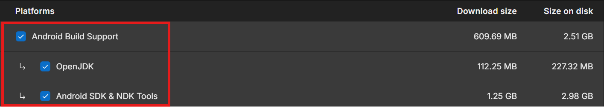

2. Meta Horizon Link und Meta Quest Developer Hub (MQDH) sind installiert (nur Windows bzw. macOS).
3. Ein USB-C-Datenkabel liegt bereit. Reine Ladekabel übertragen keine Daten. Das bei der Quest enthaltene Kabel reicht.

Auf Rechnern, auf denen Link nicht genutzt werden kann (macOS, Linux oder Grafikkarte ohne Link-Unterstützung), wird die Szene ausschließlich als APK getestet. Alternativ wird an einem Labor-PC gearbeitet.

### VS Code als Skripteditor einrichten

Wird Visual Studio Code statt Visual Studio verwendet, wird es einmalig wie folgt eingerichtet:

1. In VS Code wird die Erweiterung **Unity** (Herausgeber: Microsoft) installiert. Die benötigten Erweiterungen *C#* und *C# Dev Kit* werden dabei automatisch mitinstalliert.
2. In Unity wird unter **Window → Package Management → Package Manager → In Project** geprüft, ob das Paket **Visual Studio Editor** installiert ist. Trotz des Namens wird es auch für VS Code benötigt.
3. Unter **Edit → Preferences → External Tools** wird bei **External Script Editor** der Eintrag *Visual Studio Code* ausgewählt.
4. Mit **Regenerate project files** werden die Projektdateien für VS Code erzeugt.
5. Ein Doppelklick auf ein C#-Skript öffnet es nun in VS Code. Funktionieren Autovervollständigung und Fehlermarkierungen, ist die Einrichtung abgeschlossen.

Dieser Schritt kann auch nach dem Anlegen des Projekts durchgeführt werden.

### Meta XR All-in-One SDK zu den eigenen Assets hinzufügen

Im Kurs wird das **Meta XR All-in-One SDK** verwendet. Es bündelt unter anderem das *Core SDK* (Kamera-Rig, Tracking, Projekteinstellungen), das *Interaction SDK* (Greifen, Zeigen, Drücken) sowie Audio-, Haptics- und Platform-SDK.

1. Im Browser wird der [Unity Asset Store](https://assetstore.unity.com/) geöffnet und die Anmeldung mit der Unity ID vorgenommen.
2. Die Seite [Meta XR All-in-One SDK](https://assetstore.unity.com/packages/sdk/meta-xr-sdk-9022845) wird geöffnet.
3. Mit **Add to My Assets** bzw. **Add N packages** werden die Pakete dem eigenen Konto hinzugefügt.

> **Falls der Button keine Wirkung zeigt:** Das Unity-Konto hat die Lizenzvereinbarung des Asset Stores noch nicht akzeptiert. Dazu wird ein beliebiges kostenloses Asset hinzugefügt, die Lizenzabfrage bestätigt und anschließend das Meta-SDK erneut hinzugefügt.

### Unity-Projekt anlegen

1. Im Unity Hub wird **Projects → New project** gewählt.

   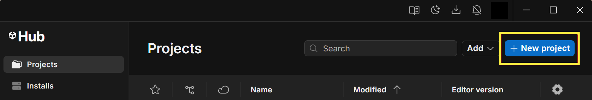

2. Als Editor-Version wird **6000.3.18f1** ausgewählt.
3. Die Vorlage **Universal 3D** wird gewählt (gegebenenfalls zuvor mit **Download template** heruntergeladen). Sie erzeugt ein leeres Projekt mit der Universal Render Pipeline (URP).
4. Projektname und Speicherort werden festgelegt. Der Pfad sollte möglichst kurz sein und keine Sonderzeichen oder Umlaute enthalten, etwa `C:\Unity\XRT_Woche2`. Ein Ordner, der von einem Cloud-Dienst synchronisiert wird (z. B. OneDrive, Sciebo, Dropbox), wird nicht verwendet.

   > **Warum kein Cloud-Ordner?** Unity schreibt während der Arbeit ständig tausende Dateien, vor allem in die Ordner `Library` und `Temp`. Ein Sync-Dienst versucht, jede dieser Änderungen sofort hochzuladen, und sperrt dabei Dateien kurzzeitig. Die Folgen sind Importfehler, fehlgeschlagene Builds, ein stark verlangsamter Editor und im schlimmsten Fall beschädigte Szenen oder Konfliktkopien. Außerdem werden mehrere Gigabyte an Zwischendateien übertragen, die Unity jederzeit selbst neu erzeugen kann.
   >
   > **Besser: Git und GitHub.** Soll ein Projekt auf zwei Rechnern genutzt werden, etwa auf dem eigenen Laptop und einem Labor-PC, wird es über ein Git-Repository abgeglichen. Dabei wird nur übertragen, was wirklich zum Projekt gehört (`Assets`, `Packages`, `ProjectSettings`). Die Zwischendateien werden über die `.gitignore` ausgeschlossen und auf jedem Rechner lokal neu aufgebaut. Synchronisiert wird nur bei einem bewussten Commit, Push oder Pull, nicht mitten in einem laufenden Import. Jeder Stand ist mit einer Beschreibung gesichert und kann wiederhergestellt werden, wenn eine Änderung das Projekt beschädigt hat. Bei Gruppenarbeit werden Änderungen mehrerer Personen nachvollziehbar zusammengeführt, statt sich gegenseitig zu überschreiben. Die Einrichtung des Repositorys erfolgt in der BS-Phase.
5. Mit **Create project** wird das Projekt angelegt.

   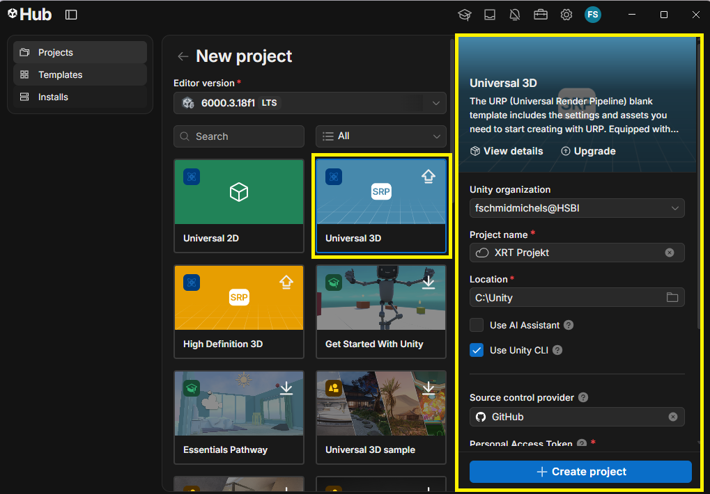

### OpenXR-Plugin aktivieren

1. Über **Edit → Project Settings** werden die Projekteinstellungen geöffnet.

   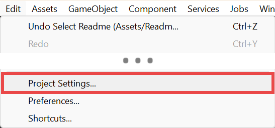

2. Links wird **XR Plug-in Management** gewählt. Falls noch nicht vorhanden, wird es mit **Install XR Plugin Management** installiert.

   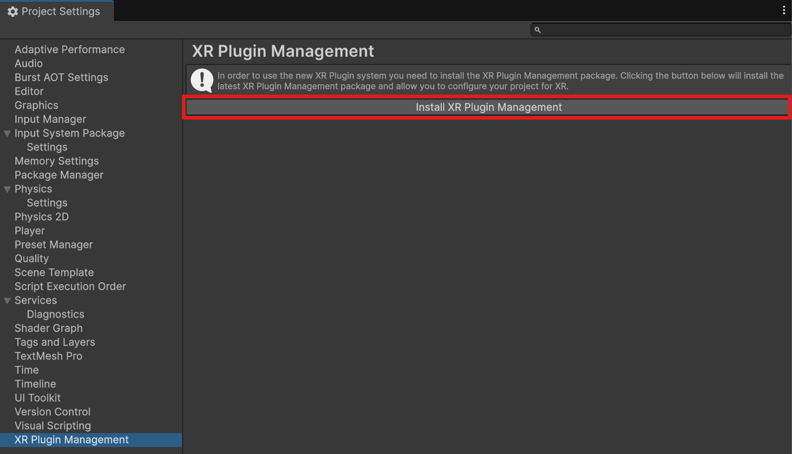

3. Im Reiter **Standalone** (Monitor-Symbol) wird **OpenXR** aktiviert. Diese Einstellung wird für die Vorschau über Link benötigt.

   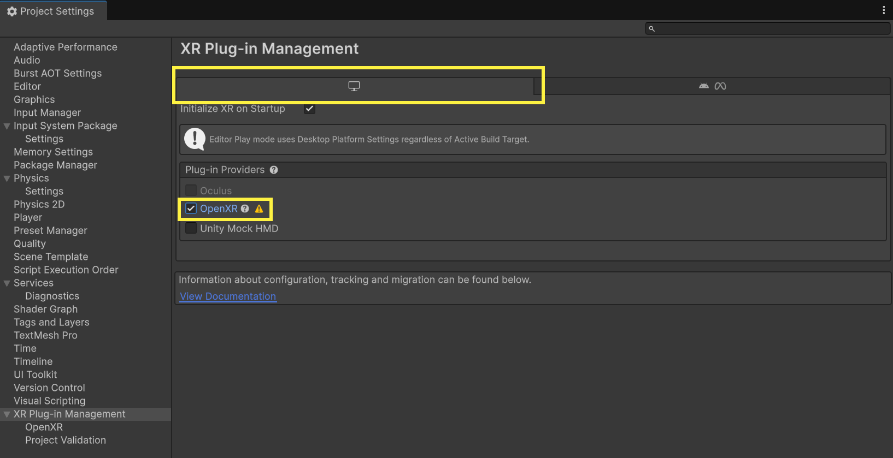

4. Im Reiter **Meta** bzw. **Android** wird ebenfalls **OpenXR** aktiviert. Diese Einstellung wird für die APK auf der Quest benötigt.

   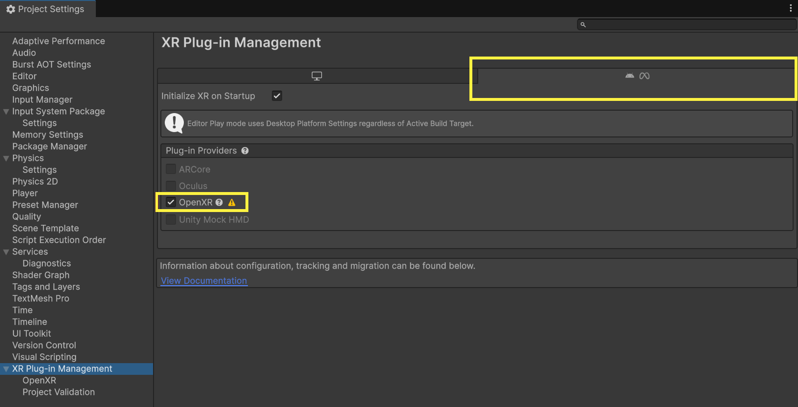

### Build-Plattform Meta Quest wählen

1. Über **File → Build Profiles** wird das Fenster für die Build-Profile geöffnet.
2. Unter **Platforms** wird **Meta Quest** ausgewählt und mit **Enable Platform** bzw. **Switch Platform** aktiviert.

   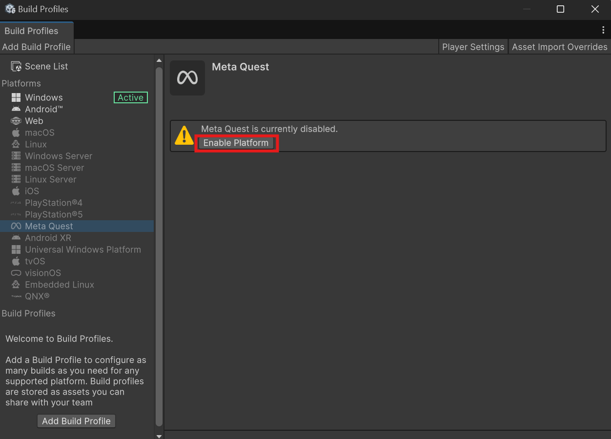

3. Falls die Installation von `com.unity.xr.openxr` angeboten wird, wird sie mit **Install** bestätigt.

Der Plattformwechsel kann einige Minuten dauern, weil Assets für Android neu importiert werden.

### Meta XR All-in-One SDK installieren

1. Über **Window → Package Management → Package Manager** wird der Package Manager geöffnet.

   

     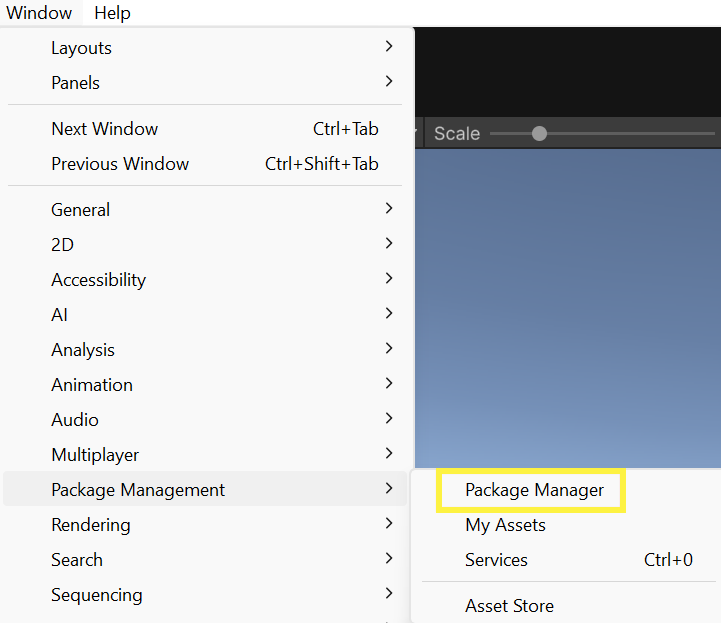
   

2. Links wird **My Assets** gewählt. Dort erscheinen die zuvor im Asset Store hinzugefügten Meta-Pakete.
3. **Meta XR All-in-One SDK** wird ausgewählt und mit **Install** installiert. Die enthaltenen Pakete werden dabei automatisch mitinstalliert.
4. Die Abfrage zum Aktivieren des **Meta XR Feature Set** wird mit **Enable** bestätigt.

   

     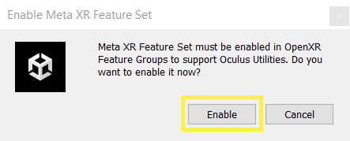
   

   Erscheint keine Abfrage, wird unter **Project Settings → XR Plug-in Management** in den Reitern Standalone und Meta geprüft, ob die Feature-Gruppe **Meta XR** aktiviert ist.

5. Die Aufforderung zum Neustart wird mit **Restart Editor** bestätigt.

   

     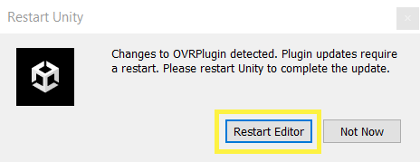
   

6. Erscheint eine Abfrage zum *Hand Skeleton Upgrade*, wird **Use OpenXR Hand** gewählt.

### Konfiguration mit Project Setup Tool und Project Validation korrigieren

Das Meta XR SDK prüft zahlreiche Projekteinstellungen, etwa Grafik-API, Farbraum oder Android-Mindestversion, und kann diese automatisch korrigieren.

1. Über **Meta XR SDK → Project Setup Tool** wird das Prüfwerkzeug geöffnet. Ist das Fenster nicht sichtbar, wird es über **Window → Meta → Meta XR SDK** geöffnet. In Unity 6000.3 kann das SDK-Menü zusätzlich über einen Rechtsklick auf die Toolbar (**Meta XR SDK → SDK menu**) angeheftet werden.

   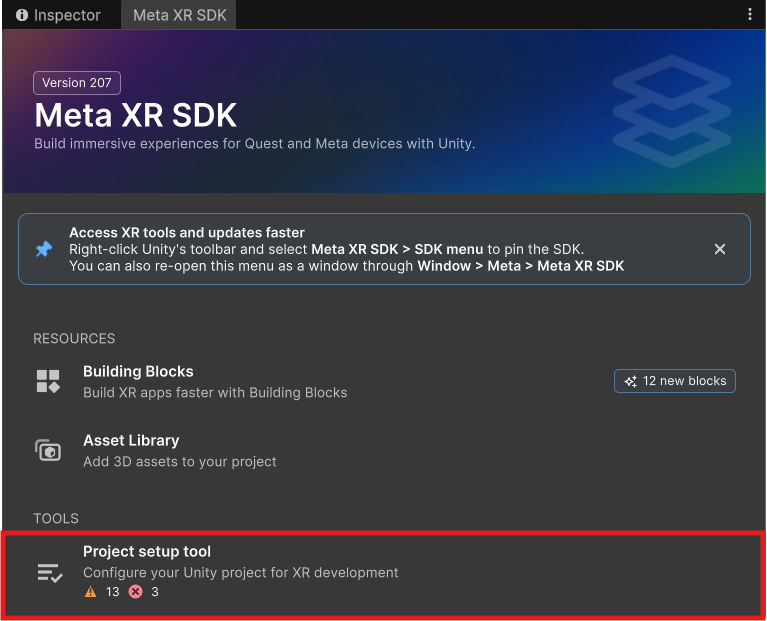

2. In den Reitern **Standalone** und **Meta** wird jeweils **Fix All** und anschließend **Apply All** ausgeführt.

   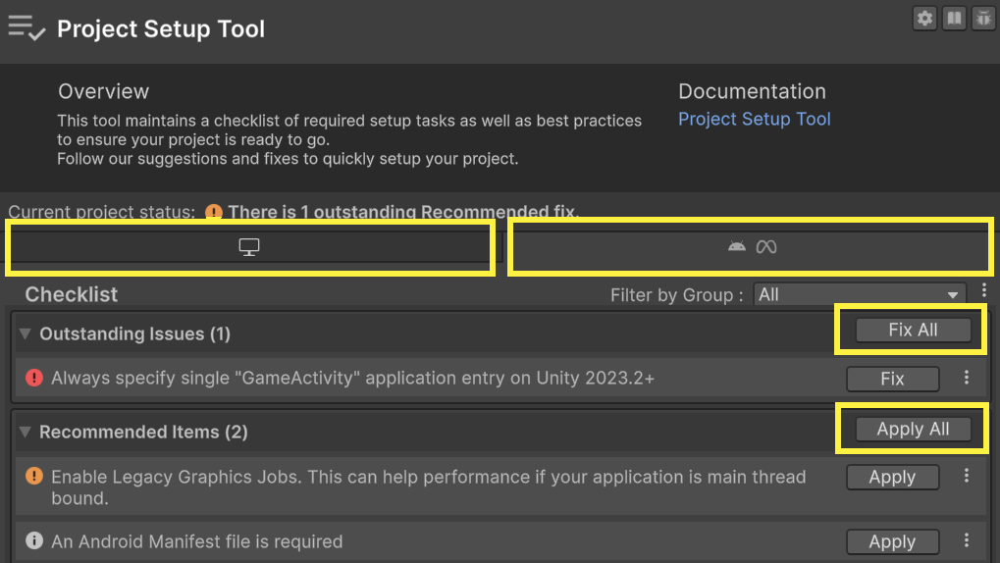

3. Unter **Project Settings → XR Plug-in Management → Project Validation** wird in beiden Reitern ebenfalls **Fix All** bzw. **Apply All** ausgeführt.

   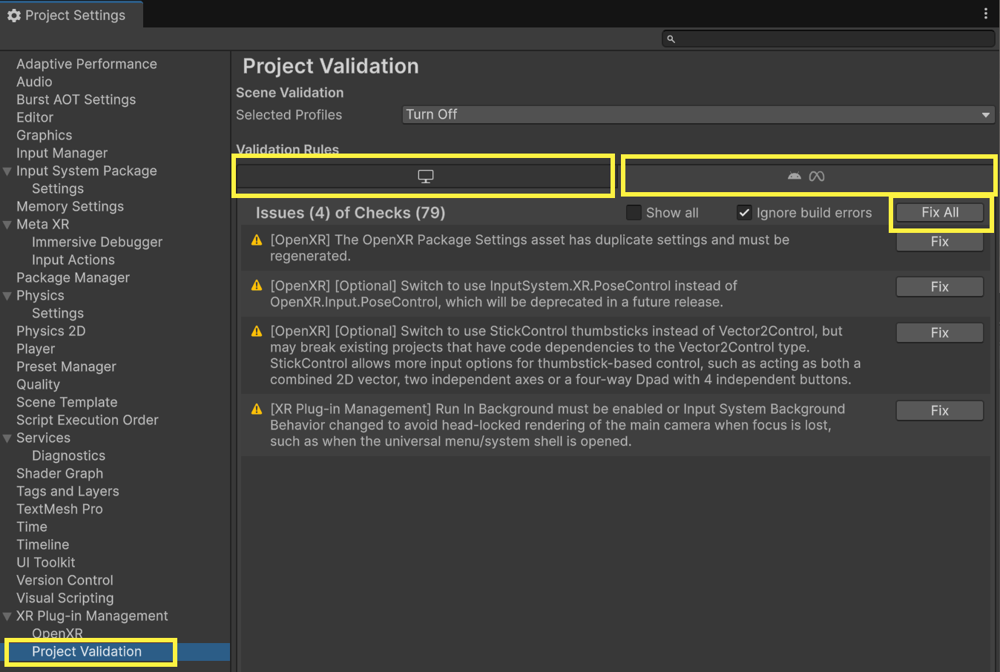

4. Bleiben einzelne Hinweise bestehen, werden sie gelesen. Hinweise, die als *Recommended* oder *Optional* markiert sind, verhindern in der Regel keinen lauffähigen Build.
5. Beim OpenXR Plugin wird standardmäßig kein Update angezeigt, aber ein Klick auf **Version History** zeigt neuere Versionen.

### OpenXR Feature Groups prüfen

1. Unter **Project Settings → XR Plug-in Management → OpenXR** wird der Reiter **Android** bzw. **Meta** gewählt.
2. Im Bereich **OpenXR Feature Groups** wird **Meta XR** gewählt.
3. Es wird geprüft, ob **Meta XR Feature**, **Meta XR Foveation** und **Meta XR Subsampled Layout** aktiviert sind.

   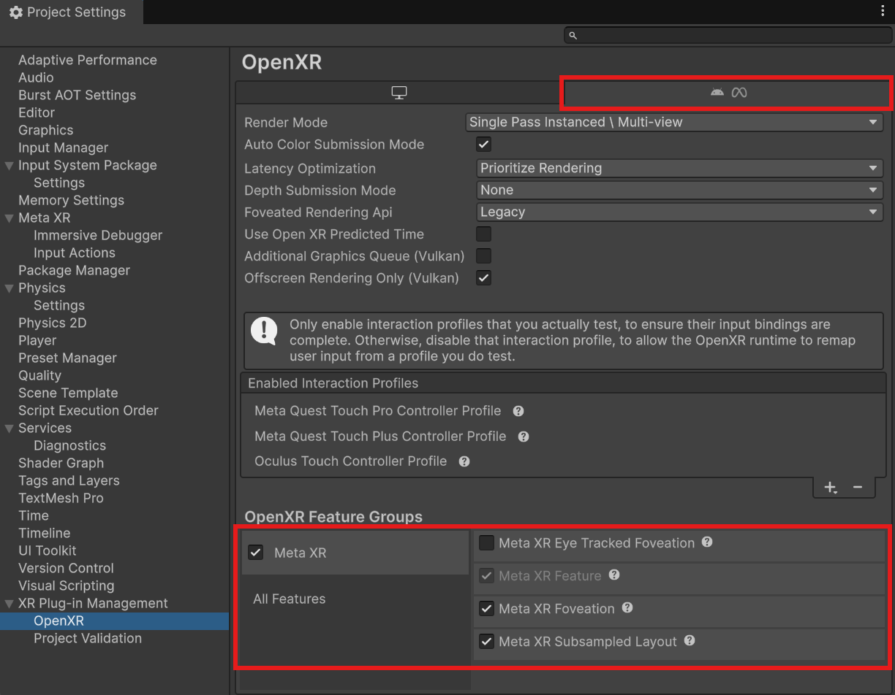

### Einordnung: Was wurde eingerichtet?

| Ebene | Aufgabe | Im Projekt |
|---|---|---|
| **OpenXR** | Offener, herstellerübergreifender Standard der Khronos Group. Definiert, wie Anwendungen Headset-Pose, Controller, Hände und Darstellung bei der XR-Laufzeitumgebung abfragen. | XR Plug-in Management → OpenXR |
| **Meta XR Feature Group** | Meta-spezifische OpenXR-Erweiterungen, etwa Passthrough, Foveated Rendering oder Hand-Tracking-Details. | OpenXR Feature Groups → Meta XR |
| **Meta XR Core SDK** | Unity-Komponenten für Kamera-Rig, Tracking und Projekteinrichtung, außerdem Building Blocks. | Teil des All-in-One SDK |
| **Meta XR Interaction SDK** | Fertige Interaktionen wie Greifen, Zeigen, Drücken und Ferngreifen für Controller und Hände. | Teil des All-in-One SDK |

Die Anwendung spricht also nicht direkt mit der Hardware, sondern über OpenXR mit der Laufzeitumgebung der Quest. Das Meta XR SDK baut darauf auf und ergänzt Meta-spezifische Funktionen. Andere Stacks, etwa das Unity XR Interaction Toolkit, verwenden ebenfalls OpenXR, benennen und strukturieren Rig und Interaktionen aber anders. Im XR Interaction Toolkit entspricht beispielsweise der *XR Origin* ungefähr dem *Camera Rig*.

## Block 3 – XR-Grundgerüst, Vorschau und Geräte-Build

### Camera Rig hinzufügen

1. In der **Hierarchy** wird das Objekt **Main Camera** aus der `SampleScene` gelöscht. Eine normale Unity-Kamera folgt nicht der Kopfbewegung.

   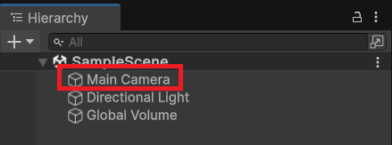

2. Über **Meta XR SDK → Building Blocks** wird die Übersicht der Building Blocks geöffnet.

   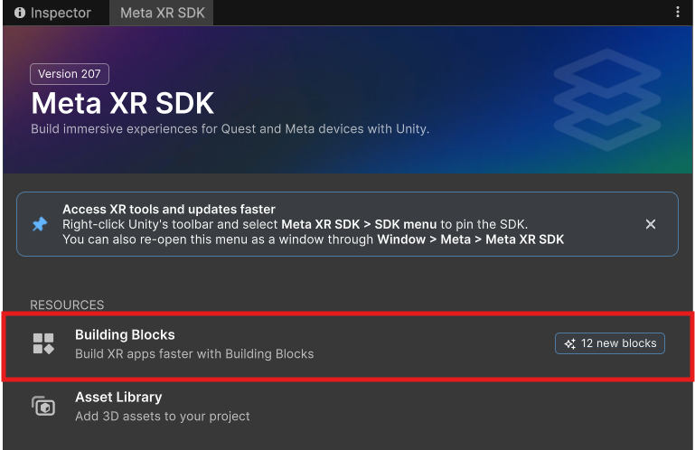

3. Beim Building Block **Camera Rig** wird über das Symbol unten rechts der Block zur Szene hinzugefügt.

   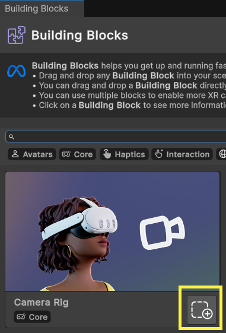

4. In der Hierarchy wird geprüft, ob das Camera Rig vorhanden ist.

   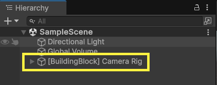

### Aufbau des Camera Rigs untersuchen

Das Camera Rig wird in der Hierarchy aufgeklappt. Die wichtigsten Bestandteile werden gemeinsam besprochen:

| Objekt | Bedeutung |
|---|---|
| **Camera Rig** (`OVRCameraRig`, `OVRManager`) | Wurzelobjekt. Seine Position legt fest, wo sich der reale Spielbereich in der virtuellen Welt befindet. Im `OVRManager` wird unter anderem der **Tracking Origin Type** eingestellt. |
| **TrackingSpace** | Bezugssystem des Trackings. Alle getrackten Positionen werden relativ zu diesem Objekt angegeben. |
| **CenterEyeAnchor** | Enthält die eigentliche Kamera und folgt der Kopfbewegung. Seine Position wird vom Tracking gesetzt und darf nicht per Skript überschrieben werden. |
| **LeftEyeAnchor / RightEyeAnchor** | Positionen der beiden Augen für die stereoskopische Darstellung. |
| **LeftHandAnchor / RightHandAnchor** | Folgen den Controllern bzw. getrackten Händen. Hier werden Controller- und Handmodelle sowie Interaktoren angehängt. |

**Tracking Origin:** Mit der Einstellung **Floor Level** liegt der Ursprung auf dem realen Boden; die Kamerahöhe ergibt sich aus der tatsächlichen Körpergröße. Mit **Eye Level** liegt der Ursprung auf Augenhöhe beim Start. Für das Bowling wird **Floor Level** verwendet, damit Bahn und Kugel auf dem realen Boden stehen.

**Maßstab:** In Unity entspricht eine Einheit einem Meter. Ein Würfel mit Skalierung 1 ist im Headset also ein Meter groß.

### Grab Interaction hinzufügen

1. In den Building Blocks wird der Block **Grab Interaction** zur Szene hinzugefügt. Dabei wird automatisch der Building Block **Interactions Rig** als Abhängigkeit ergänzt. Er enthält die Interaktoren für Controller und Hände (Greifen, Zeigen, Drücken) und wird unterhalb des Camera Rigs eingehängt. In der Hierarchy erscheint er als eigenes Objekt **[BuildingBlock] OVRComprehensiveInteractionRig** als Unterobjekt des **Camera Rig**.

   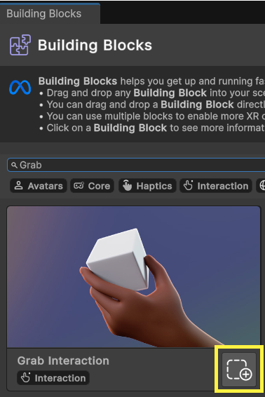

2. In der Hierarchy wird **[BuildingBlock] Cube** ausgewählt.

   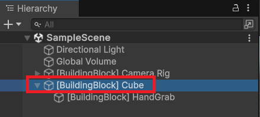

3. Im **Inspector** wird unter **Transform** die Position auf **(0, 1, 0.25)** gesetzt. Der Würfel befindet sich damit etwa einen Meter über dem Boden und 25 cm vor dem Startpunkt.

   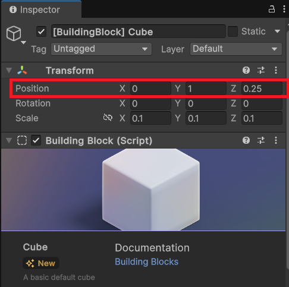

### Headset für die Entwicklung vorbereiten

Die Labor-Headsets werden über die Geräteverwaltung von Meta betrieben. Ein persönliches Meta-Entwicklerkonto und die Meta Horizon App werden deshalb nicht benötigt. USB-Debugging wird direkt im Headset eingeschaltet:

1. Im Headset werden die **Einstellungen** geöffnet.
2. Links wird bis **Entwickler** gescrollt.
3. Die Option **USB-Debugging** wird eingeschaltet.
4. Die Quest wird per USB-C-Datenkabel mit dem Rechner verbunden.
5. Die Meldung **USB erkannt** wird angeklickt. Eventuell versteckt sich diese in den Benachrichtigungen (im Menü das Glocken-Symbol).
6. Meta Quest Developer Hub **MQHD** starten.
7. Die im Headset erscheinende Anfrage wird mit **Von diesem Computer immer zulassen** bestätigt.
8. In **MQDH** wird geprüft, ob das Headset als verbundenes Gerät angezeigt wird.

Falls die Option fehlt oder gesperrt ist, wird dies den Dozenten gemeldet. Einstellungen der Geräteverwaltung werden nicht umgangen.

### Vorschau über Meta Horizon Link

Über Link wird die Szene direkt aus dem Unity-Editor auf das Headset übertragen. Änderungen können so ohne Build getestet werden. Die Szene wird dabei vom Rechner berechnet; das Headset dient nur als Anzeige- und Eingabegerät.

1. Die Meta Horizon Link App wird auf dem Rechner gestartet.
2. Die Quest wird per USB-C verbunden. Im Headset wird **Link** aktiviert. Falls keine Abfrage erscheint, wird Link über **Schnelleinstellungen → Einstellungen → Link** gestartet.
3. In Unity wird **Play** gedrückt.

   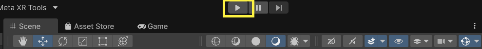

4. Der Würfel wird mit dem Controller über die **Grip-Taste** gegriffen. Sind die Controller abgelegt, wird er mit der Hand über eine **Pinch-Geste** (Daumen und Zeigefinger zusammenführen) gegriffen.

   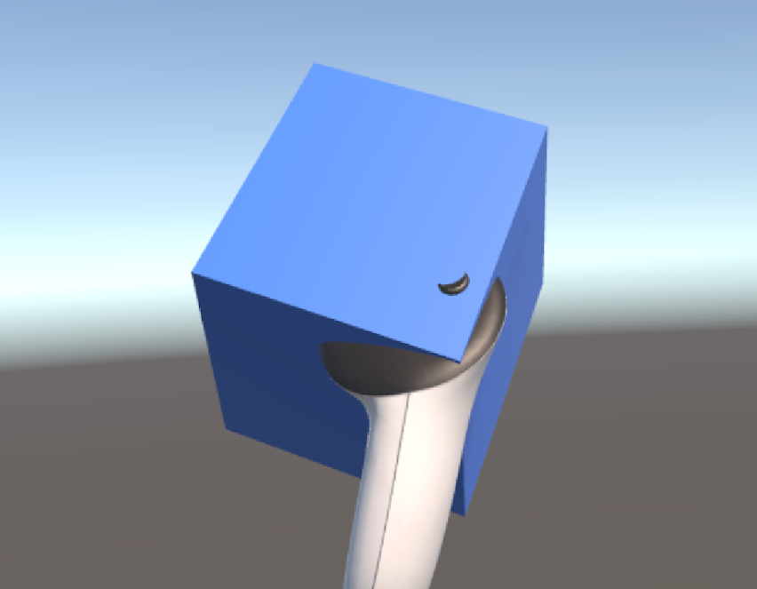 
   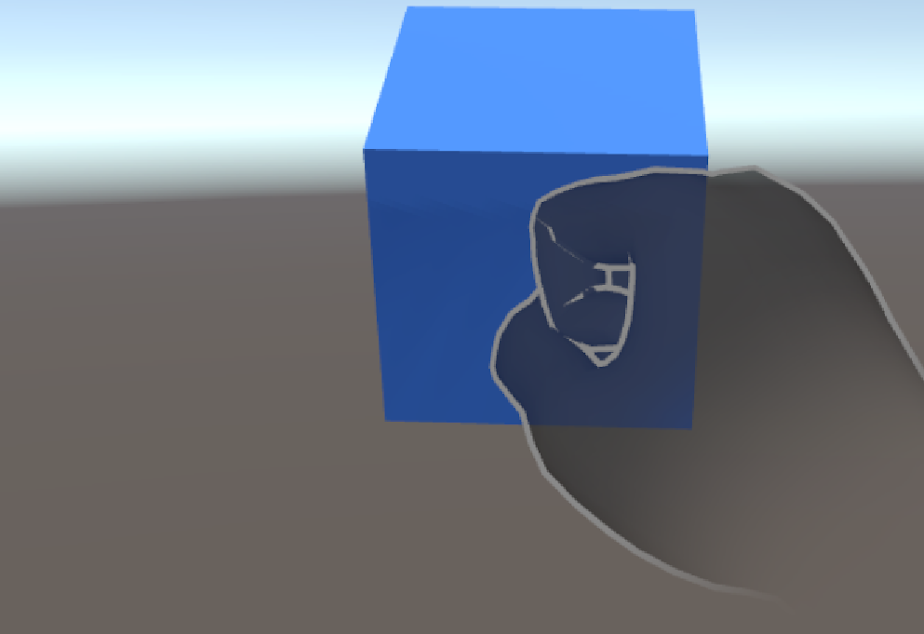

**Plan B ohne Link:** Steht Link nicht zur Verfügung, wird direkt mit dem nächsten Abschnitt (APK) fortgefahren oder ein Labor-PC verwendet. Ergänzend kann der [Meta XR Simulator](https://developers.meta.com/horizon/documentation/unity/xrsim-intro/) eingesetzt werden, mit dem eine Szene ohne Headset am Rechner getestet wird. Der Simulator ersetzt jedoch nicht den Test auf dem Gerät.

### APK bauen, installieren und eigenständig starten

Für die Prüfung wird eine **eigenständig auf der Quest 3 laufende APK** erwartet. Der Build-Prozess wird deshalb bereits jetzt geübt.

#### App-Namen und Paketnamen festlegen

Vor dem ersten Build werden Name und Kennung der App festgelegt. Ohne Anpassung erscheint die App unter einem generischen Namen, und Projekte verschiedener Personen können sich gegenseitig überschreiben.

1. Über **Edit → Project Settings → Player** werden die Player-Einstellungen geöffnet. Alternativ wird im Fenster **Build Profiles** die Schaltfläche **Player Settings** verwendet.
2. Im oberen Bereich werden eingetragen:
   - **Company Name:** z. B. `HSBI`;
   - **Product Name:** der Anzeigename der App im Headset, z. B. `XRT Woche 2 – Nachname`;
   - **Version:** z. B. `0.1.0`.
3. Unter **Other Settings → Identification** wird **Override Default Package Name** aktiviert und ein eigener **Package Name** eingetragen, z. B. `de.hsbi.xrt.nachname.woche2`. Der Paketname darf nur Kleinbuchstaben, Ziffern, Punkte und Unterstriche enthalten und keine Umlaute, Leerzeichen oder Bindestriche. Jedes Segment beginnt mit einem Buchstaben.
4. Optional wird unter **Icon** ein eigenes App-Symbol hinterlegt.

Android unterscheidet Apps ausschließlich am **Paketnamen**. Eine APK mit demselben Paketnamen ersetzt eine bereits installierte App, auch wenn sie aus einem anderen Projekt stammt. Wird der Paketname später geändert, wird die App als zusätzliche, neue App installiert. Für jedes eigene Projekt (Kursprojekt, Einzelprüfung, Gruppenprojekt) wird deshalb ein eigener, eindeutiger Paketname verwendet.

#### Build durchführen

1. Die Szene wird gespeichert (**Strg+S**).
2. Unter **File → Build Profiles → Meta Quest** wird geprüft, ob die aktuelle Szene in der **Scene List** enthalten und aktiviert ist. Falls nicht, wird sie mit **Add Open Scenes** ergänzt.
3. Die Quest ist per USB-C verbunden und USB-Debugging ist aktiv. Link wird im Headset zuvor beendet.
4. Mit **Build And Run** wird ein Speicherort für die APK gewählt, beispielsweise ein Ordner `Builds` neben dem Ordner `Assets`. Unity baut die APK, installiert sie auf der Quest und startet sie.
5. Der erste Build dauert mehrere Minuten. Spätere Builds sind deutlich schneller.
6. Das USB-Kabel wird abgezogen und die Anwendung im Headset erneut gestartet. Sie befindet sich unter dem eingestellten **Product Name** in der **Bibliothek** unter dem Filter **Unbekannte Quellen** (*Unknown Sources*).

**Alternative:** Eine bereits gebaute APK wird in MQDH unter dem verbundenen Gerät per Drag-and-drop bzw. **Add Build** installiert.

### Link-Vorschau und APK im Vergleich

| Aspekt | Vorschau über Link | APK auf der Quest |
|---|---|---|
| Berechnung | auf dem Rechner | auf dem Prozessor der Quest |
| Iteration | schnell, ohne Build | langsamer, Build bei jeder Änderung |
| Leistung | abhängig von der Grafikkarte des Rechners | realistische Leistung des Zielgeräts |
| Kabel bzw. Rechner | während der Nutzung erforderlich | nach der Installation nicht erforderlich |
| Plattform | nur Windows | Windows und macOS (Build) |
| Prüfungsrelevanz | nur Entwicklungshilfe | bewertet wird die Standalone-Ausführung |

Eine Szene, die über Link flüssig läuft, kann auf der Quest selbst zu langsam sein. Bestimmte Fehler, etwa fehlende Szenen in der Scene List oder Android-spezifische Einstellungen, zeigen sich ebenfalls erst in der APK. Deshalb wird regelmäßig auch auf dem Gerät getestet.

## Block 4 – Building Blocks erkunden und Fehler eingrenzen

### Drei grundlegende Building Blocks umsetzen

Die folgenden drei Building Blocks werden **verbindlich** zur Szene hinzugefügt und im Headset getestet. Sie bilden die Grundlage für fast alle weiteren Interaktionen im Kurs.

| Building Block | Funktion | Test im Headset | Dokumentation |
|---|---|---|---|
| **Passthrough** | Die reale Umgebung wird als Live-Bild hinter den virtuellen Objekten angezeigt (Mixed Reality). | Prüfen, ob der Würfel im realen Raum erscheint und wie gut Position und Größe eingeschätzt werden können. | [Passthrough API Overview](https://developers.meta.com/horizon/documentation/unity/unity-passthrough/) |
| **Controller Tracking** | Position und Ausrichtung der Controller werden erfasst und als 3D-Modell dargestellt. | Controller in die Hand nehmen; prüfen, ob die virtuellen Controller den realen Bewegungen folgen; Wechsel zwischen Controllern und Händen beobachten. | [Controller Input and Tracking Overview](https://developers.meta.com/horizon/documentation/unity/unity-ovrinput/) |
| **Hand Tracking** | Hände und Fingerstellungen werden ohne Controller erfasst und dargestellt. | Controller ablegen; Hände drehen, öffnen und schließen; den Würfel per Pinch greifen. | [Hand Tracking Overview](https://developers.meta.com/horizon/documentation/unity/unity-handtracking-overview/) |

Eine Übersicht aller Building Blocks bietet die Seite [Building Blocks Overview](https://developers.meta.com/horizon/documentation/unity/unity-building-blocks-overview/).

Building Blocks können voneinander abhängen und fehlende Abhängigkeiten automatisch ergänzen. Das Inspector-Feld **Dependencies** bzw. **Used by** am jeweiligen Building-Block-Objekt zeigt diese Beziehungen.

Für jeden Block wird untersucht:

1. Welche **GameObjects** wurden in der Hierarchy angelegt, und wo befinden sie sich (z. B. unter dem Camera Rig)?
2. Welche **Komponenten** tragen diese Objekte?
3. Welche **Projekteinstellungen** wurden gegebenenfalls verändert, beispielsweise Passthrough im `OVRManager`?
4. Wie verhält sich die Funktion im Headset, und welche Rückmeldung erhält die nutzende Person?

Bei der Bewertung werden die Gestaltungskriterien aus Woche 1 herangezogen, etwa: Ist jederzeit erkennbar, ob gerade Controller oder Hände als Eingabe verwendet werden?

Die Szene mit allen drei Building Blocks wird abschließend als APK gebaut und auf der Quest getestet.

### Einordnung: Warum funktioniert das Greifen schon ohne Controller und Hand Tracking?

Der Würfel aus Block 3 lässt sich bereits mit Controllern und Händen greifen, obwohl die Building Blocks *Controller Tracking* und *Hand Tracking* noch nicht hinzugefügt wurden. Das liegt daran, dass Erfassung, Daten und Darstellung im Meta XR SDK auf verschiedene Bausteine verteilt sind:

- **Erfassung durch das Camera Rig:** `OVRCameraRig` und `OVRManager` lesen in jedem Frame über OpenXR die Position und Ausrichtung von Kopf, Controllern und Händen aus und setzen damit `CenterEyeAnchor`, `LeftHandAnchor` und `RightHandAnchor`. Dies geschieht auch dann, wenn an den Ankern nichts Sichtbares hängt.
- **Greifen durch das Interactions Rig:** Das mit *Grab Interaction* automatisch ergänzte Interactions Rig bringt eigene Datenquellen für Controller- und Handposen, eigene Interaktoren für Greifen, Zeigen und Drücken sowie eigene Darstellungen von Controllern und Händen mit. Im Interaction SDK sind das sogenannte *synthetische Hände*, die sich beim Greifen an Objekte anpassen können.
- **Controller Tracking:** Der Block ergänzt vor allem die **Darstellung** der Controller als 3D-Modelle (`OVRControllerPrefab` bzw. Runtime-Controller-Modelle) unter den Hand-Ankern.
- **Hand Tracking:** Der Block ergänzt das **Handmodell** (`OVRMesh`, `OVRMeshRenderer`) und zusätzlich **Datenkomponenten des Core SDK**, die eigene Skripte direkt nutzen können:
  - `OVRHand` liefert z. B. die Pinch-Stärke je Finger und die Tracking-Konfidenz.
  - `OVRSkeleton` liefert Position und Rotation der einzelnen Fingerknochen.

  Außerdem stellt der Block sicher, dass im `OVRManager` unter **Hand Tracking Support** die Handerfassung erlaubt ist (*Controllers and Hands* bzw. *Hands Only*).

| Baustein | Funktion | Daten für eigene Skripte | Einstellungen |
|---|---|---|---|
| **Camera Rig** | Erfassung von Kopf, Controllern und Händen; stereoskopische Kamera | Anker-Positionen | `OVRManager`: **Tracking Origin Type** (*Floor Level* für das Bowling), **Hand Tracking Support** (*Controllers Only*, *Controllers and Hands*, *Hands Only*), **Passthrough Support** bzw. *Enable Passthrough*, **Target Devices** (Quest 3) |
| **Interactions Rig** | Interaktoren für Greifen, Zeigen und Drücken; eigene Darstellung von Händen und Controllern | über das Interaction SDK | Interaktoren je Hand bzw. Controller einzeln aktivieren oder deaktivieren (z. B. Grab, Poke, Ray, Teleport); eigene Hand- und Controller-Darstellung ein- oder ausblenden |
| **Controller Tracking** | Darstellung der Controller-Modelle | Position der Knöpfe etc. z. B. für Hinweise, Animationen | Zuordnung linker bzw. rechter Controller; Modellart (fest hinterlegtes Modell oder zur Laufzeit geladenes Systemmodell); Sichtbarkeit, wenn auf Handtracking gewechselt wird |
| **Hand Tracking** | Darstellung des Handmodells; Bereitstellung der Handdaten | `OVRHand`, `OVRSkeleton` | `OVRHand`/`OVRSkeleton`: **Hand Type** bzw. **Skeleton Type** (links/rechts); Material des Handmodells; `OVRManager`: **Hand Tracking Support** und **Hand Tracking Frequency** |

Die Bezeichnungen der Einstellungen können je nach SDK-Version leicht abweichen. Sie werden im Inspector des jeweiligen Objekts nachgeschlagen.

**Beobachtungsaufgabe:** Nach dem Hinzufügen von Controller Tracking und Hand Tracking erscheinen möglicherweise **doppelte Controller- oder Handmodelle**: eines vom Interactions Rig und eines vom neuen Building Block. Es wird untersucht, welche Objekte neu angelegt wurden, welche bereits vorhanden waren und welche Darstellung in der Szene tatsächlich sichtbar ist. Die Felder *Dependencies* und *Used by* im Inspector helfen bei der Zuordnung.

### Fehler systematisch eingrenzen

Funktioniert eine Interaktion nicht, wird der Fehler schrittweise eingegrenzt, statt Einstellungen zufällig zu verändern. Beobachtung und vermutete Ursache werden wie in Woche 1 getrennt festgehalten.

| Ebene | Typisches Symptom | Prüfschritt |
|---|---|---|
| **Build** | App startet nicht oder zeigt ein schwarzes Bild; App fehlt unter *Unbekannte Quellen*. | Scene List prüfen; Project Setup Tool und Project Validation erneut ausführen; Build-Log in der Konsole lesen. |
| **Tracking** | Kopf- oder Handbewegungen werden nicht übernommen; Ansicht steckt im Boden. | Ist das Camera Rig vorhanden und die Main Camera gelöscht? Stimmt der Tracking Origin Type? Ist der Spielbereich im Headset eingerichtet? |
| **Input** | Hände bzw. Controller sind sichtbar, aber Greifen reagiert nicht. | Wird die richtige Taste bzw. Geste verwendet? Sind die Interaktor-Objekte unter dem Camera Rig vorhanden und aktiv? |
| **Collider** | Hand bzw. Controller greift durch das Objekt hindurch. | Hat das Objekt einen Collider? Passt seine Größe zur sichtbaren Form? Ist **Is Trigger** ungewollt aktiv? |
| **Interaktionskonfiguration** | Objekt wird erkannt, bewegt sich aber nicht oder fällt sofort herunter. | Sind Grabbable und Interactable vorhanden und verknüpft? Ist der Rigidbody korrekt eingestellt? |

Pro Fehler wird jeweils nur eine Einstellung verändert und anschließend erneut getestet.

### Optional: Weitere Interaktionen ausprobieren

Dieser Teil wird bearbeitet, wenn die drei Pflicht-Building-Blocks fertig sind und die APK läuft. Die folgenden Building Blocks werden nach dem gleichen Vorgehen hinzugefügt, im Headset getestet und untersucht: angelegte Objekte, Komponenten, Abhängigkeiten und Verhalten.

| Building Block | Funktion | Test im Headset | Dokumentation |
|---|---|---|---|
| **Poke Interaction** | Eine virtuelle Fläche bzw. Schaltfläche wird mit Fingerspitze oder Controller gedrückt. | Die Schaltfläche mit dem Finger und mit dem Controller drücken; Rückmeldung beim Drücken beobachten. | [Poke Interactions](https://developers.meta.com/horizon/documentation/unity/unity-isdk-poke-interaction/) |
| **Ray Interaction** | Von Hand oder Controller geht ein Strahl aus, mit dem entfernte Objekte bzw. Oberflächen ausgewählt werden. | Mit dem Strahl auf Objekte zielen und auswählen; Hand und Controller vergleichen. | [Ray Interactions](https://developers.meta.com/horizon/documentation/unity/unity-isdk-ray-interaction/) |
| **Teleport** | Fortbewegung durch Zielen und Teleportieren an eine gewählte Position. | Ein Ziel auf dem Boden anvisieren und dorthin teleportieren; Orientierung nach dem Sprung und Komfort beobachten. | [Locomotion Interactions](https://developers.meta.com/horizon/documentation/unity/unity-isdk-locomotion-interactions/) |

Leitfragen:

- Welche dieser Interaktionen nutzen bereits vorhandene Teile des Interactions Rigs, und welche ergänzen neue Objekte?
- Wodurch wird erkennbar, dass eine Schaltfläche gedrückt, ein Objekt per Strahl ausgewählt oder ein Teleportziel gültig ist?
- Wie wird die Orientierung nach einer Teleportation unterstützt? Hier sind die Kriterien zur Fortbewegung aus Woche 1 heranzuziehen.

**Hinweis:** In der Einzelprüfung ist mindestens eine virtuelle Fortbewegungsart gefordert, beispielsweise Teleportation (siehe [Prüfungsaufgaben](../Pruefung/Pruefungsaufgaben.md)). Eine erste Erprobung von *Teleport* lohnt sich deshalb bereits jetzt.

## Zentrale Begriffe

| Begriff | Arbeitsdefinition |
|---|---|
| **OpenXR** | Offener Standard für die Kommunikation zwischen XR-Anwendung und XR-Laufzeitumgebung; ermöglicht herstellerübergreifende Anwendungen. |
| **Meta XR All-in-One SDK** | Paketbündel von Meta für Unity mit Core SDK, Interaction SDK und weiteren SDKs (Audio, Haptics, Platform u. a.). |
| **Interaction SDK** | Teil des Meta XR SDK mit fertigen Interaktionen wie Greifen, Zeigen und Drücken für Controller und Hände. |
| **Building Block** | Vorkonfigurierter Baustein des Meta XR SDK, der Objekte, Komponenten und Einstellungen für eine Funktion automatisch zur Szene hinzufügt. |
| **Camera Rig** | Objekthierarchie, die Kopf, Augen, Controller und Hände im virtuellen Raum abbildet. |
| **Tracking Space** | Bezugssystem, in dem die getrackten Positionen angegeben werden. |
| **Tracking Origin** | Bezugspunkt des Trackings, z. B. Boden (*Floor Level*) oder Augenhöhe beim Start (*Eye Level*). |
| **Meta Horizon Link** | Verbindung, über die der Rechner die Szene berechnet und an das Headset überträgt. |
| **APK** | Android-Installationspaket; Format, in dem Anwendungen eigenständig auf der Quest installiert werden. |
| **USB-Debugging** | Freigabe, über die ein Rechner Anwendungen auf dem Headset installieren und Protokolle auslesen darf. |
| **Project Setup Tool** | Werkzeug des Meta XR SDK, das Projekteinstellungen prüft und automatisch korrigiert. |

## 2 h BS – Vertiefung und Stabilisierung

In der BS-Phase wird das Projekt stabilisiert und zu einer kleinen Ausgangsszene für das Bowling ausgebaut.

1. **Geräte-Build wiederholen:** Der Weg von einer Änderung bis zur laufenden APK wird so lange wiederholt, bis er zuverlässig funktioniert. Offene Einrichtungsprobleme werden mit den Dozenten geklärt.
2. **Einfache Umgebung gestalten:** Mit Modellen und Texturen von [Poly Haven](https://polyhaven.com/) wird eine einfache Umgebung gestaltet, beispielsweise ein Boden mit Textur, ein Tisch und eine passende Beleuchtung. Die Assets von Poly Haven stehen unter CC0 und dürfen ohne Namensnennung verwendet werden; die Quelle wird trotzdem im README vermerkt. Nach dem Import wird der **Maßstab** geprüft: Ein Tisch ist etwa 0,75 m hoch. Auf eine geringe Polygonzahl und Texturauflösung (z. B. 1K) wird geachtet, da die Szene auf der Quest berechnet wird.
3. **Startanleitung anlegen:** Im Projektordner wird eine Datei `README.md` mit folgenden Angaben angelegt:
   - Unity-Version und verwendete Render-Pipeline;
   - installierte XR-Pakete und SDK-Versionen (abzulesen im Package Manager);
   - Schritte zum Öffnen, Bauen und Installieren;
   - verwendete externe Assets mit Quelle und Lizenz;
   - gegebenenfalls eingesetzte KI-Werkzeuge und deren Zweck.
4. **Versionskontrolle einrichten/kontrollieren:** Das Projekt wird in einem Git-Repository verwaltet. Dafür wird eine für Unity geeignete `.gitignore` verwendet, etwa die Vorlage *Unity* von GitHub. Die Ordner `Library`, `Temp`, `Obj`, `Logs`, `UserSettings` sowie der Build-Ordner werden nicht versioniert.
5. **Optionale Building Blocks:** Falls in Block 4 noch nicht geschehen, werden die optionalen Building Blocks *Poke Interaction*, *Ray Interaction* und *Teleport* umgesetzt und im Headset getestet (siehe [Optional: Weitere Interaktionen ausprobieren](#optional-weitere-interaktionen-ausprobieren)).

## Vor- und Nachbereitung außerhalb der Präsenz

Die Einrichtungsschritte und der Build-Prozess werden nachvollzogen, bis sie ohne Anleitung wiederholt werden können. Bei Bedarf werden die Unity-Grundlagen aus der Vorbereitung nachgearbeitet, insbesondere GameObjects, Komponenten, Rigidbody und Collider.

Verbleibende Einrichtungsprobleme werden mit Fehlermeldung, bereits versuchten Lösungsschritten und verwendeten Versionen dokumentiert, damit sie in Woche 3 gezielt geklärt werden können.

Als Nachschlagewerk dient die [Meta-Dokumentation für Unity](https://developers.meta.com/horizon/develop/unity/), insbesondere die Abschnitte zu Building Blocks und zum Interaction SDK.

## Ergebnis der Woche

Zum Abschluss werden folgende Ergebnisse zusammengeführt:

- eingerichtetes Unity-Projekt mit OpenXR und Meta XR All-in-One SDK;
- Szene mit Camera Rig und greifbarem Würfel;
- umgesetzte Building Blocks Passthrough, Controller Tracking und Hand Tracking;
- eigenständig auf der Quest 3 laufende APK;
- einfache Umgebung;
- Startanleitung (`README.md`) und Projekt unter Versionskontrolle;
- ergänzter Kriterienkatalog aus den App-Vorstellungen.

### Muster-Projekt

Ein Muster-Projekt mit dem Stand dieser Woche steht auf GitHub zur Verfügung:

> <https://github.com/fschmidmichels/HSBI-xReality-Technologien-Unity>

Das Muster-Projekt dient zum Vergleich und zur Fehlersuche, etwa um Projekteinstellungen oder Komponenten mit dem eigenen Stand abzugleichen. Es ersetzt nicht die eigene Umsetzung.

## Aufgabe bis Woche 3 – Einen Building Block vertiefen und vorstellen

Jede Person befasst sich intensiv mit **einem** der folgenden Building Blocks. Die Zuteilung erfolgt durch die Dozenten. Zu Beginn von Woche 3 wird der Building Block in **5 Minuten einschließlich Demo** vorgestellt. So entsteht ein gemeinsamer Überblick über Funktionen, die für das Bowling und die späteren Gruppenprojekte genutzt werden können.

| Nr. | Building Block | Funktion | Bezug zum Kurs (ungefähre Planung) | Person |
|---|---|---|---|---|
| 1 | **Distance Grab** | Objekte werden aus der Entfernung durch Zeigen und Greifgeste herangeholt. | Rückholung einer weit entfernten Kugel (Woche 3) | … |
| 2 | **Touch Hand Grab** | Objekte werden bei Berührung gegriffen; die Finger passen sich der Objektform an. | natürliches Greifen der Kugel mit Handtracking (Woche 3) | … |
| 3 | **Effect Mesh** | Erkannte Flächen des realen Raums (Boden, Wände, Möbel) erhalten Materialien, Effekte oder Collider. | Kugel rollt auf dem realen Boden bzw. prallt an realen Wänden ab; Mixed-Reality-Variante des Bowlings | … |
| 4 | **Controller Buttons Mapper** | Controller-Tasten werden ohne eigene Abfragelogik mit Aktionen verknüpft. | Neustart bzw. Reset per Taste (Woche 4 oder 5) | … |
| 5 | **Haptics** | Controller-Vibration als taktile Rückmeldung wird ausgelöst. | Rückmeldung beim Greifen und bei Treffern (Woche 5) | … |
| 6 | **Spatial Audio** | Schallquellen werden räumlich positioniert, sodass Richtung und Entfernung hörbar werden. | Roll- und Aufprallgeräusche (Woche 5) | … |
| 7 | **Anchor Prefab Spawner** | Prefabs werden an erkannten Elementen des realen Raums platziert, z. B. auf Boden, Tisch oder Wand. | Bowlingbahn in Mixed Reality im eigenen Raum platzieren | … |
| 8 | **Room Guardian** | Eine sichtbare Begrenzung warnt, sobald man sich realen Wänden oder Hindernissen nähert. | Sicherheit beim Anlauf und Wurf im realen Raum; Gestaltungskriterien zur Sicherheit aus Woche 1 | … |

### Vorbereitung

1. Die offizielle Dokumentation zum zugeteilten Building Block und zu der zugrunde liegenden Funktion wird gelesen. Einstieg: [Building Blocks Overview](https://developers.meta.com/horizon/documentation/unity/unity-building-blocks-overview/).
2. Der Building Block wird in einer **eigenen Demo-Szene** im Projekt aus Woche 2 umgesetzt und als APK auf der Quest getestet.
3. Folgende Fragen werden untersucht:
   - Welche GameObjects und Komponenten legt der Building Block an? Welche anderen Building Blocks werden als Abhängigkeit ergänzt?
   - Welche Einstellungen im Inspector sind wichtig, und wie verändern sie das Verhalten? Mindestens **eine Einstellung wird gezielt verändert** und die Wirkung im Headset verglichen.
   - Welche Projekteinstellungen, Berechtigungen oder Voraussetzungen werden benötigt (z. B. Passthrough aktiviert, Raum eingescannt, Handtracking aktiviert)?
   - Welche Grenzen oder Probleme sind aufgetreten, und wie wurden sie gelöst?
   - Wie könnte der Building Block im Bowling oder in einem eigenen Projekt sinnvoll eingesetzt werden? Welche Gestaltungskriterien aus Woche 1 sind dabei zu beachten?
4. Für die Vorstellung wird ein kurzer **Videoclip** der Demo direkt auf der Quest aufgenommen (Richtwert 30–60 Sekunden, siehe Kurzanleitung aus Woche 1). Eine Live-Demonstration wird nicht vorausgesetzt.

### Vorstellung in Woche 3

Die Vorstellung umfasst **5 Minuten einschließlich Video** und folgt dieser Gliederung:

| Inhalt | Richtwert |
|---|---|
| Funktion des Building Blocks in einem Satz | 30 Sekunden |
| Videoclip der Demo | 30–60 Sekunden |
| Aufbau: angelegte Objekte, Komponenten und Abhängigkeiten | 1 Minute |
| wichtige Einstellungen, Voraussetzungen und aufgetretene Probleme | 1,5 Minuten |
| Einsatzidee für Bowling bzw. Gruppenprojekt | 1 Minute |

Zusätzlich wird eine **kurze Schrittanleitung** (max. eine Seite, Markdown) zur Einrichtung des Building Blocks erstellt und auf der gemeinsamen Austauschplattform bereitgestellt. Die Anleitungen aller Personen ergeben zusammen ein Nachschlagewerk für den weiteren Kurs.

**Hinweis:** Einige Building Blocks setzen Mixed-Reality-Funktionen voraus, etwa ein eingerichtetes Raummodell (*Space Setup*) bei Effect Mesh, Anchor Prefab Spawner und Room Guardian. Der Raum wird nur innerhalb des freigegebenen Spielbereichs gescannt. Lässt sich eine Funktion mit den Labor-Headsets nicht umsetzen, wird dies dokumentiert und frühzeitig mit den Dozenten abgestimmt.
