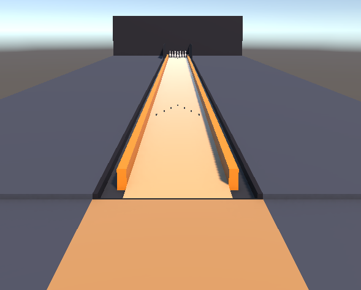
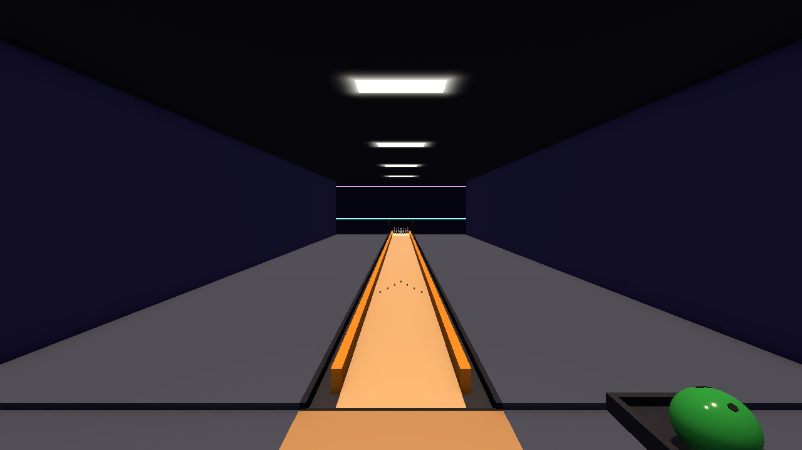

# Woche 3: Kugel greifen, loslassen und werfen

## Überblick

In der dritten Woche wird aus dem Referenzprojekt aus Woche 2 die erste spielbare Bowlingszene. Eine eigene Bowlingkugel wird greifbar gemacht, eine Bahn mit Pins nach echten Maßen aufgebaut und das Werfen systematisch untersucht: Was geschieht beim Greifen, Halten, Loslassen und Rollen, und woran liegt es, wenn ein Wurf unplausibel wirkt?

Als gemeinsames Ergebnis entsteht eine Szene, in der die Kugel zuverlässig gegriffen und geworfen wird, Pins physikalisch plausibel umfallen und eine verlorene Kugel zurückgeholt werden kann.

**Umfang:** 4 h Praktikum + 2 h Betreutes Selbststudium.

Grundlage ist das eigene Projekt aus Woche 2 mit Camera Rig und Interactions Rig. Für Block 3 wird ein Paket mit Pin-Modell, Referenzbahn und Halle bereitgestellt (siehe [Bereitgestellte Assets](#bereitgestellte-assets)). Als maßgebliche Quelle für das Interaction SDK dient die offizielle Dokumentation:

> **Meta Interaction SDK – Grab Interactions:** <https://developers.meta.com/horizon/documentation/unity/unity-isdk-grab-interaction/>

## Lernziele

Im Verlauf der Veranstaltung werden folgende Kompetenzen aufgebaut:

- Erklärung des Übergangs von getrackter Hand- bzw. Controllerbewegung zu physikalischer Objektbewegung;
- Unterscheidung der Phasen Greifen, Halten, Loslassen, Werfen und Rollen sowie Benennung der jeweils beteiligten Komponenten;
- Konfiguration eines greifbaren Objekts mit Collider, Rigidbody, Grabbable, Interactable und Greifposition;
- Aufbau einer Szene nach realen Maßen unter Berücksichtigung von Masse, Reibung und Maßstab;
- Unterscheidung statischer und dynamischer Objekte sowie Steuerung von Kollisionen über Layer;
- Erkennen und Behandeln von Fehlerfällen wie verlorenen oder unerreichbaren Kugeln;
- Vergleich von Interaktionsvarianten in einem einfachen Test mit anderen Personen.

## Block 1 – Vorstellung der Building Blocks

### Vorstellungen

Die Building Blocks aus der Aufgabe bis Woche 3 (siehe [Woche 2](../Woche_2/Woche_2.md#aufgabe-bis-woche-3--einen-building-block-vertiefen-und-vorstellen)) werden vorgestellt. Pro Person stehen **5 Minuten einschließlich Video** zur Verfügung (8 Personen, also ca. 40 Minuten). Die Kurzanleitungen werden auf der Austauschplattform gesammelt.

### Auswahl für das Bowling

Im Anschluss wird kurz festgehalten, welche Building Blocks wann in das Bowling übernommen werden:

| Building Block | Verwendung im Bowling | Woche |
|---|---|---|
| **Touch Hand Grab** | Greifposition der Kugel mit Hand-Tracking (Block 2) | 3 |
| **Distance Grab** | Rückholung einer weit entfernten Kugel (BS) | 3 |
| **Room Guardian** | Sicherheit beim Anlauf und Wurf im realen Raum | 3 |
| **Controller Buttons Mapper** | Neustart bzw. Reset per Taste | 4 |
| **Haptics**, **Spatial Audio** | Rückmeldung beim Greifen und bei Treffern; Roll- und Aufprallgeräusche | 5 |
| **Effect Mesh**, **Anchor Prefab Spawner** | Mixed-Reality-Variante des Bowlings | Gruppenprojekte |

### Sicherheit beim Werfen

Ab dieser Woche werden echte Wurfbewegungen ausgeführt. Dabei gilt:

- Die **Handschlaufen** der Controller werden immer angelegt. Beim Loslassen der Kugel wird nur die Grip-Taste gelöst, der Controller selbst bleibt in der Hand.
- Vor dem Wurf wird geprüft, ob im Schwungbereich des Arms niemand steht. Testende Personen und Beobachtende halten mindestens 2 m Abstand.
- Der Spielbereich (Guardian) wird so eingerichtet, dass Anlauf und Ausholbewegung vollständig hineinpassen.
- Bei Unwohlsein, etwa durch Teleport oder Kamerabewegungen, wird die Brille sofort abgesetzt.

## Block 2 – Greifbare Kugel

### Eine Kugel greifbar machen

Als Vorbereitung auf das Bowling wird eine eigene Kugel greifbar gemacht, ohne den Building Block *Grab Interaction* erneut zu verwenden.

1. Über **GameObject → 3D Object → Sphere** wird eine Kugel angelegt und `BowlingBall` genannt. Sie wird auf einen Durchmesser von **0,218 m** skaliert (Scale 0.218 in jeder Richtung) und neben dem Würfel platziert.
2. Die Kugel erhält einen **Rigidbody** mit folgenden Einstellungen. Der vorhandene **Sphere Collider** bleibt erhalten.
   - **Mass:** 7 (Kilogramm, siehe [Maße einer echten Bowlingbahn](#maße-einer-echten-bowlingbahn));
   - **Interpolate:** *Interpolate*, damit die Kugel auch zwischen den Physikschritten flüssig dargestellt wird;
   - **Collision Detection:** *Continuous Dynamic*, damit eine schnelle Kugel nicht durch dünne Objekte hindurchfliegt.
3. Mit einem Rechtsklick auf die Kugel in der Hierarchy wird **Interaction SDK → Add Grab Interaction** gewählt. Im anschließenden Assistenten werden die Standardeinstellungen übernommen und mit **Create** bestätigt. Je nach SDK-Version kann die Bezeichnung des Menüpunkts leicht abweichen.
4. Die Szene wird im Headset getestet: Die Kugel wird gegriffen, losgelassen und geworfen.
5. Die Komponenten der Kugel werden mit denen des Building-Block-Würfels aus Woche 2 verglichen.

| Komponente | Aufgabe |
|---|---|
| **Collider** | Definiert die physikalische Form für Kollisionen und für die Erkennung des Greifbereichs. |
| **Rigidbody** | Macht das Objekt zu einem physikalischen Körper mit Masse und Schwerkraft. |
| **Grabbable** | Bewegt das Objekt, solange es gegriffen wird, und steuert das Verhalten beim Loslassen. |
| **Grab Interactable / Hand Grab Interactable** | Legt fest, dass und wie das Objekt mit Controller bzw. Hand gegriffen werden kann. |

Folgende Fragen werden untersucht:

- Was passiert, wenn der Rigidbody entfernt oder **Is Kinematic** aktiviert wird?
- Was passiert beim Loslassen der Kugel? Wird die Bewegung der Hand übernommen? Welche Einstellung am **Grabbable** steuert das (*Throw When Unselected*)?
- Wie verändert sich das Wurfgefühl, wenn die Masse von 7 kg auf 1 kg gesenkt wird?
- Was passiert, wenn die Kugel vom Tisch fällt oder außer Reichweite gerät?

Abschließend wird die Kugel als **Prefab** gespeichert, indem sie aus der Hierarchy in einen Ordner `Assets/Bowling/Prefabs` gezogen wird. Alle weiteren Änderungen werden am Prefab vorgenommen.

### Kugelablage ergänzen

Für die Kugel wird eine Ablage geschaffen, etwa ein Tablett mit niedrigem Rand oder eine Mulde. Dabei werden die Gestaltungskriterien aus Woche 1 berücksichtigt, zum Beispiel Auffindbarkeit und Erreichbarkeit ohne unnötiges Bücken. Als Richtwert dient eine Greifhöhe von etwa **0,8 m** seitlich neben dem Startpunkt. Der Rand muss hoch genug sein, damit die Kugel nicht herunterrollt, aber niedrig genug, um sie bequem greifen zu können.

### Greifposition festlegen

Eine echte Bowlingkugel wird mit zwei Fingern und dem Daumen in Grifflöchern gehalten. Damit diese Orientierung auch in VR erkennbar ist, erhält die Kugel Grifflöcher und eine definierte Greifposition.

1. **Grifflöcher:** Drei kleine, dunkle Zylinder (Durchmesser 2,2–2,5 cm, sehr flach) werden als Kinder der Kugel knapp unter ihrer Oberfläche platziert: zwei Fingerlöcher nebeneinander und das Daumenloch etwa 10 cm entfernt. Die **Collider der Zylinder werden entfernt**, damit sie Greifen und Rollen nicht stören.
2. **Hand-Tracking – Hand Grab Pose:** Am *Hand Grab Interactable* der Kugel wird eine **Hand Grab Pose** angelegt. In der Scene View erscheint eine Geisterhand, die so ausgerichtet wird, dass die Grifflöcher zur Handfläche zeigen. Mit **Hand Alignment** = *Align On Grab* dreht sich die Kugel beim Greifen automatisch in diese Lage. Die Vorstellung zu *Touch Hand Grab* aus Block 1 liefert dazu die Details. Die genauen Bezeichnungen im Inspector können je nach SDK-Version abweichen.
3. **Controller – Grab Source:** Mit Controllern greift das Interactions Rig über das *Grab Interactable*, das keine Hand Grab Pose verwendet. Dort wird stattdessen ein leeres Kindobjekt als **Grab Source** eingetragen. Beim Greifen wird dieser Punkt samt Ausrichtung an den Griffpunkt des Controllers gezogen. Position und Drehung werden im Headset so lange angepasst, bis die Kugel natürlich am Controller sitzt.

Leitfrage: Woran erkennt die nutzende Person, wie die Kugel gerade in der Hand liegt, und hilft die automatische Ausrichtung oder irritiert sie?

### Ungewollte Kollisionen mit dem eigenen Rig vermeiden

Das Interactions Rig enthält einen Körper-Collider für die Fortbewegung (Objekt `PlayerController` unter `Locomotor`, Layer **Water**). Ohne weitere Einstellung kann der eigene Körper die Kugel wegstoßen. Steht man auf der Kugel, wird man außerdem angehoben, weil sie niedriger ist als die erlaubte Stufenhöhe des Character Controllers.

1. Unter **Edit → Project Settings → Tags and Layers** wird ein neuer Layer `BowlingBall` angelegt.
2. Das Kugel-Prefab wird samt allen Kindobjekten auf diesen Layer gesetzt.
3. Unter **Edit → Project Settings → Physics → Layer Collision Matrix** wird das Häkchen zwischen `BowlingBall` und `Water` entfernt.

Der Layer *Water* ist ein in Unity fest eingebauter Layer. Das Interaction SDK nutzt ihn als Spieler-Layer, weil ein Paket keine eigenen Layer zum Projekt hinzufügen kann. Der neue Layer `BowlingBall` liegt außerdem nicht in der Layer-Maske, mit der der Character Controller den Boden sucht. Damit zählt die Kugel nicht mehr als Stufe.

## Block 3 – Bowlingbahn bauen



### Maße einer echten Bowlingbahn

Die folgenden Werte gelten für Tenpin-Bowling. Sie werden vom United States Bowling Congress (USBC) festgelegt und von World Bowling sowie der Deutschen Bowling Union übernommen. Da in Unity eine Einheit einem Meter entspricht, sind alle Werte zusätzlich in Metern und Kilogramm angegeben.

#### Bahn

| Maß | Original | Metrisch |
|---|---|---|
| Länge von der Foul-Linie bis zur Mitte von Pin 1 | 60 ft | 18,29 m |
| Anlauf vor der Foul-Linie | mind. 15 ft | ≥ 4,57 m |
| Breite der Bahn ohne Rinnen | 41,5 in (± 0,5 in) | 1,054 m |
| Anzahl der Bretter in der Breite | 39 | je ca. 2,7 cm |
| Breite einer Rinne | ca. 9,25 in | ca. 0,235 m |
| Tiefe der Rinne (flache Rinne, an der letzten Pin-Reihe) | 3 3/8–3 5/8 in | 8,6–9,2 cm |
| Lage der Zielpfeile | ca. 12–16 ft hinter der Foul-Linie | ca. 3,7–4,9 m |
| Abstand zweier Pins (Mitte zu Mitte) | 12 in | 0,3048 m |
| Aufstellung der Pins | gleichseitiges Dreieck mit 4 Reihen (1-2-3-4) | Seitenlänge 0,914 m |

#### Kugel

| Maß | Original | Metrisch |
|---|---|---|
| Höchstgewicht | 16 lb | 7,3 kg |
| Mindestgewicht | keines | übliche Kugeln: 2,7–7,3 kg |
| Durchmesser | 8,500–8,595 in | 21,59–21,83 cm |

Erwachsene spielen meist mit Kugeln von 5,4 bis 7,3 kg (12–16 lb).

#### Pin

| Maß | Original | Metrisch |
|---|---|---|
| Gewicht | 3 lb 6 oz bis 3 lb 10 oz | 1,53–1,64 kg |
| Höhe | 15 in | 38,1 cm |
| Breite an der dicksten Stelle | ca. 4,75 in | ca. 12,1 cm |

#### Übertragung nach Unity

| Objekt | Empfohlene Werte |
|---|---|
| Kugel | Rigidbody `Mass` = 7, Sphere mit Scale 0.218 (Radius ca. 0,109 m) |
| Pin | Rigidbody `Mass` = 1.6, Höhe 0,381 m, Collider als Capsule mit flachem Fuß |
| Bahn | Boden 1,054 m × 18,29 m, Pins 0,3048 m voneinander entfernt |

- Die Kugel ist etwa 4- bis 4,5-mal so schwer wie ein Pin. Dieses Verhältnis bestimmt maßgeblich, wie plausibel die Pins umfallen, und sollte deshalb erhalten bleiben.
- Kugel und Pins behalten ihre realen Maße, damit Greifen und Werfen in VR glaubwürdig wirken.
- Der Anlauf ist der einzige Bereich, in dem man sich bewegt. Er bestimmt deshalb die Größe der benötigten Play Area. Im Muster-Projekt ist er auf 3 m verkürzt; die Bahn selbst behält ihre echte Länge.

**Quellen:** [Tenpin bowling – Wikipedia](https://en.wikipedia.org/wiki/Tenpin_bowling), [Bowling pin – Wikipedia](https://en.wikipedia.org/wiki/Bowling_pin), [USBC Equipment Specifications](https://bowl.com/equipment-specifications/manufacturers), [USBC Tiered Center Certification Handbook (05/2025), S. 3](https://bowl.com/getmedia/5d757433-f147-4c1e-b941-1a8e02394a36/May-2025_Tiered-Center-Certification-Handbook_final.pdf) (Rinnentiefe und -breite, Toleranzen für Bahnlänge, Bahnbreite und Pin-Abstand)

### Bereitgestellte Assets

Im Ordner [`Assets für Unity`](Assets%20für%20Unity/) liegt das Paket **`XRT_Bowling_Woche3.unitypackage`**. Es wird über **Assets → Import Package → Custom Package…** importiert und legt den Ordner `Assets/Bowling` an.

| Inhalt | Verwendung |
|---|---|
| `Prefabs/CollidableBowlingPin.prefab` | Pin mit echten Maßen, Rigidbody (1,6 kg), Collidern und Umfall-Erkennung (`Pin.cs`) – für die eigene Bahn |
| `Prefabs/BowlingLane.prefab` | Referenzbahn mit Anlauf, Rinnen, Bumpern, Pit, Trigger-Zonen und 10 Pins |
| `Prefabs/BowlingHall.prefab` | Indoor-Halle mit Wänden, Decke, Pinsetter-Verkleidung und Beleuchtung |
| Materialien, Physik-Materialien, Pin-Geräusche | werden von den Prefabs verwendet; die Geräusche werden erst in Woche 5 behandelt |

Das Pin-Modell stammt aus dem Tutorial [VRTK.Tutorials.VRBowling](https://github.com/ExtendRealityLtd/VRTK.Tutorials.VRBowling) (MIT-Lizenz, Lizenztext in `Assets/Bowling/LICENSE_VRTK.md`), die Pin-Geräusche von [freesound.org](https://freesound.org/people/Bruce%20Burbank/sounds/151204/) (CC0). Eine Übersicht aller Quellen und Lizenzen des Pakets liegt in `Assets/Bowling/QUELLEN.md`. Die Quellen werden in das eigene README übernommen.

### Eigene Bahn aus einfachen Körpern

Zuerst wird eine einfache Bahn selbst gebaut. Dabei wird geübt, Maße aus der Realität in Unity zu übertragen. Die Foul-Linie liegt bei z = 0, die Bahn verläuft in +z-Richtung, und die Oberfläche der Bahn liegt auf Höhe y = 0.

1. Ein leeres GameObject `MyLane` wird im Ursprung angelegt. Alle Teile werden darunter einsortiert.
2. **Bahn:** Ein Cube mit Scale **(1.054, 0.1, 19.16)** an Position **(0, −0.05, 9.58)**. Die Oberkante liegt damit bei y = 0, und die Bahn reicht bis kurz hinter die letzte Pin-Reihe.
3. **Anlauf:** Ein Cube mit Scale **(1.6, 0.1, 3)** an Position **(0, −0.05, −1.5)**. Er liegt vor der Foul-Linie und ist der Bereich, in dem man steht.
4. **Bumper:** Zwei Cubes mit Scale **(0.1, 0.2, 18.6)** an Position **(±0.577, 0.05, 9.3)**. Sie verhindern, dass die Kugel seitlich von der Bahn rollt.
5. **Pins:** Das Prefab `CollidableBowlingPin` wird zehnmal unter `MyLane` eingefügt und auf die folgenden Positionen gesetzt. Der Pivot des Modells liegt im Pin-Kopf, deshalb ist y = **0.331** und nicht 0. Die Rotation des Prefabs (Z = −90) bleibt unverändert.

| Reihe | Pins | x | z |
|---|---|---|---|
| 1 | 1 | 0 | 18.288 |
| 2 | 2, 3 | −0.1524 / 0.1524 | 18.552 |
| 3 | 4, 5, 6 | −0.3048 / 0 / 0.3048 | 18.816 |
| 4 | 7, 8, 9, 10 | −0.4572 / −0.1524 / 0.1524 / 0.4572 | 19.080 |

6. Der Abstand zwischen den Reihen beträgt 0,3048 m · sin 60° ≈ 0,264 m. Die Werte werden kurz nachgerechnet.
7. Das Camera Rig wird auf den Anlauf gestellt (Position **(0, 0, −1.5)**) und die Kugelablage daneben platziert.

### Statische und dynamische Objekte

| Objektart | Beispiele | Komponenten |
|---|---|---|
| **Statisch** | Bahn, Anlauf, Bumper, Ablage | Collider, **kein** Rigidbody; im Inspector als *Static* markiert |
| **Dynamisch** | Kugel, Pins | Collider **und** Rigidbody |

Leitfragen:

- Was passiert, wenn ein Bumper versehentlich einen Rigidbody erhält?
- Warum stehen die Pins beim Start still, obwohl sie dynamisch sind? Was ändert sich, wenn ein Pin 1 cm über der Bahn startet?

### Testimpuls

Bevor im Headset geworfen wird, wird ein reproduzierbarer Wurf ohne Hand erzeugt. Dazu wird eine zweite Kugel `TestBall` (Scale 0.218, Rigidbody mit 7 kg, ohne Grab Interaction) bei **(0, 0.11, 0.5)** platziert und mit folgendem Skript versehen:

```csharp
using UnityEngine;

public class TestImpulse : MonoBehaviour
{
    public Vector3 velocity = new Vector3(0f, 0f, 7f);
    public float delay = 3f;   // Wartezeit in Sekunden, damit der Wurf beobachtet werden kann

    void Start()
    {
        Invoke(nameof(Launch), delay);
    }

    void Launch()
    {
        GetComponent<Rigidbody>().linearVelocity = velocity;
    }
}
```

Im Play Mode rollt die Kugel nach 3 Sekunden mit 7 m/s auf die Pins zu. Die Wartezeit lässt Zeit, im Headset oder in der Game View den Blick auf die Bahn zu richten; sie wird über `delay` eingestellt. Variiert werden Geschwindigkeit, seitlicher Versatz und Richtung (z. B. `velocity = (0.3, 0, 7)`). Es wird beobachtet, wie viele Pins fallen und ob das Ergebnis plausibel wirkt. Der Testimpuls bleibt in der Szene, wird aber für die Würfe im Headset deaktiviert.

### Reibung: Wie bleibt die Kugel auf der Bahn in Bewegung?

Echte Bahnen sind geölt. Eine Kugel rutscht dort zunächst und beginnt erst später zu rollen. In Unity wird dieses Verhalten über ein **Physics Material** abgebildet:

1. Im Projekt wird über **Create → Physics Material** ein Material `LaneSurface` mit **Dynamic Friction** und **Static Friction** = 0.04 sowie **Friction Combine** = *Minimum* angelegt.
2. Das Material wird dem Collider der Bahn zugewiesen.
3. Der Testimpuls wird mit und ohne das Material verglichen.

Durch *Minimum* setzt sich die niedrige Reibung der Bahn gegen die Reibung der Kugel durch. Ohne eigenes Material verwendet Unity eine Standardreibung von 0,6 und bremst die Kugel deutlich stärker.

### Referenzbahn und Halle einsetzen

Zum Abschluss des Blocks werden die Prefabs `BowlingLane` und `BowlingHall` aus dem Paket in die Szene gezogen und die eigene Bahn deaktiviert. Die Referenzbahn wird untersucht und mit der eigenen verglichen:



| Teil | Untersuchungsauftrag |
|---|---|
| **Gutters** | Wie ist die Rinne aufgebaut? Läuft eine Kugel darin nur durch Physik weiter, oder braucht es ein Skript? |
| **Bumpers** | Das Objekt `Bumpers` wird deaktiviert und wieder aktiviert. Was ändert sich beim Testimpuls mit seitlichem Versatz? |
| **Pit** und **Kickbacks** | Wohin gelangen Kugel und Pins nach dem Treffer? |
| **Zones** | Wozu könnten die Trigger `GutterZone_Left`, `GutterZone_Right` und `PitZone` dienen? (Sie werden in der BS-Phase verwendet.) |
| **BowlingHall** | Welche Lichter sind echte Lichtquellen, und welche leuchten nur über ihr Material (Emission)? Warum ist das für die Quest relevant? |

## Block 4 – Werfen, Fehlerfälle und Vergleichstest

### Bewegungsanalyse

Ein Wurf wird in Phasen zerlegt. Für jede Phase wird im Headset beobachtet, welche Komponente gerade die Kontrolle hat:

| Phase | Was technisch geschieht | Beobachtung im Headset |
|---|---|---|
| **Greifen** | Ein Interactor erkennt die Kugel; das *Grabbable* übernimmt sie und richtet sie ggf. nach der Greifposition aus. | Springt die Kugel in die Hand? Ist die Ausrichtung nachvollziehbar? |
| **Halten** | Die Kugel ist kinematisch (*Kinematic While Selected*) und folgt Hand bzw. Controller exakt; die Physik ist ausgesetzt. | Folgt die Kugel ohne Verzögerung? Durchdringt sie Ablage oder Bahn? |
| **Loslassen** | Das *Grabbable* übergibt die zuletzt gemessene Geschwindigkeit und Winkelgeschwindigkeit an den Rigidbody (*Throw When Unselected*). | Fliegt die Kugel in die erwartete Richtung? |
| **Werfen** | Die Physik übernimmt: Schwerkraft, Masse und Luftwiderstand (*Linear Damping*, in älteren Unity-Versionen *Drag*). | Landet die Kugel auf der Bahn oder prallt sie hart auf? |
| **Rollen** | Reibung zwischen Kugel und Bahn bestimmt, wann die Kugel vom Rutschen ins Rollen übergeht. | Wirkt die Bewegung auf der Bahn glaubwürdig? |

Dabei werden **Position**, **Orientierung**, **Geschwindigkeit** und **Winkelgeschwindigkeit** unterschieden. Ein Beispiel für eine Grenze der Simulation: Unity begrenzt die Winkelgeschwindigkeit eines Rigidbody standardmäßig auf 50 rad/s. Eine Kugel mit 0,109 m Radius kann deshalb oberhalb von etwa 5,5 m/s nicht vollständig mitrollen und rutscht teilweise. Auf einer geölten Bahn ist das sogar realistisch.

Die Grenze lässt sich für die Kugel anheben. Für reines Rollen gilt ω = v / r; bei 8 m/s sind etwa 73 rad/s nötig, bei 10 m/s etwa 92 rad/s. Das folgende Skript wird an das Kugel-Prefab gehängt. Der Wert erscheint im Inspector und kann dort angepasst werden, auch während des Play Mode:

```csharp
using UnityEngine;

[RequireComponent(typeof(Rigidbody))]
public class BallPhysics : MonoBehaviour
{
    [Tooltip("Maximale Winkelgeschwindigkeit in rad/s (Unity-Standard: 50).")]
    public float maxAngularVelocity = 100f;

    private Rigidbody body;

    void Awake()
    {
        body = GetComponent<Rigidbody>();
        body.maxAngularVelocity = maxAngularVelocity;
    }

    // Änderungen im Inspector werden auch während des Play Mode sofort übernommen.
    void OnValidate()
    {
        if (body != null)
        {
            body.maxAngularVelocity = maxAngularVelocity;
        }
    }
}
```

`Rigidbody.maxAngularVelocity` wird nicht im Prefab gespeichert und deshalb zur Laufzeit in `Awake()` gesetzt. Die projektweite Grenze (**Project Settings → Physics → Default Max Angular Speed**) wird nicht verändert, weil sie auch für die Pins gilt. Leitfrage: Ändert sich das Rollverhalten auf der geölten Bahn spürbar, oder rutscht die Kugel trotzdem? Was ändert sich bei einem Wurf mit starker Handgelenksdrehung?

Es werden mindestens drei **unplausible Würfe** gezielt herbeigeführt und beschrieben, zum Beispiel:

- Die Kugel wird beim Loslassen nach oben geschleudert.
- Die Kugel fällt senkrecht herunter, obwohl der Arm schwingt.
- Die Kugel springt beim Aufsetzen auf die Bahn mehrfach hoch.

Für jeden Fall wird eine Vermutung zur Ursache notiert, etwa Zeitpunkt des Loslassens, Tracking-Verlust, Greifposition oder Physikeinstellungen.

### Fehlerfälle

Folgende Fehlerfälle werden im Headset herbeigeführt und beobachtet. Lösungen werden zunächst nur skizziert und in der BS-Phase bzw. zu Hause umgesetzt.

| Fehlerfall | Beobachtung | Mögliche Behandlung |
|---|---|---|
| Kugel liegt in der Rinne oder im Pit | Sie ist für die spielende Person nicht mehr erreichbar. | Trigger-Zone erkennt die Kugel und legt sie nach kurzer Zeit zurück auf die Ablage. |
| Kugel fällt hinter dem Spieler herunter | Sie rollt in den Raum hinter dem Anlauf. | Prüfung der Position; unter einer Mindesthöhe oder außerhalb eines Bereichs wird zurückgesetzt. |
| Kugel bleibt auf der Bahn liegen | Ein zu sanfter Wurf kommt mitten auf der Bahn zum Stehen. | Nach einer Wartezeit ohne nennenswerte Geschwindigkeit wird zurückgesetzt. |
| Kugel wird versehentlich losgelassen | Sie fällt vor dem Anlauf zu Boden. | Erreichbarkeit vom Boden prüfen; ggf. *Distance Grab* (Vorstellung aus Block 1). |

### Vergleichstest

--- Wahrscheinlich zu Zeitaufwändig, wird wahrscheinlich übersprungen ---


Zwei Konfigurationen der Wurfinteraktion werden miteinander verglichen. Eine Variante wird verändert, alles andere bleibt gleich. Beispiele:

- Kugelmasse 7 kg gegenüber 4 kg;
- mit gegenüber ohne Greifposition (*Hand Grab Pose* bzw. *Grab Source*);
- Reibung der Bahn 0,04 gegenüber 0,3;
- Hand-Tracking gegenüber Controller.

Jede Variante wird von **mindestens zwei anderen Personen** mit je **fünf Würfen** getestet. Die testenden Personen kennen die Variante nicht im Voraus. Festgehalten wird:

| Feld | Eintrag |
|---|---|
| Variante | A / B, kurze Beschreibung |
| Testperson | Kürzel |
| Würfe auf der Bahn / in der Rinne / Fehlwurf | … / … / … |
| umgefallene Pins (Summe) | … |
| Kontrollierbarkeit (1 = gar nicht, 5 = sehr gut) | … |
| Plausibilität des Wurfs (1–5) | … |
| Kommentar der Testperson | … |

Beobachtung und Bewertung werden wie in Woche 1 getrennt festgehalten. Unterschiede werden erst nach allen Würfen gemeinsam besprochen.

## Zentrale Begriffe

| Begriff | Arbeitsdefinition |
|---|---|
| **Rigidbody** | Komponente, die ein Objekt zu einem physikalischen Körper mit Masse, Schwerkraft und Geschwindigkeit macht. |
| **Kinematisch** | Ein Rigidbody, der nicht von der Physik bewegt wird, sondern per Skript bzw. vom Grabbable; er stößt andere Körper aber weiterhin an. |
| **Collider** | Unsichtbare Form, die für Kollisionen und Greiferkennung verwendet wird. |
| **Trigger** | Collider ohne physikalische Wirkung, der nur meldet, wenn ein anderes Objekt ihn betritt oder verlässt. |
| **Physics Material** | Legt Reibung und Rückprall einer Oberfläche fest. |
| **Collision Detection** | Verfahren, mit dem Kollisionen erkannt werden; *Continuous* verhindert, dass schnelle Objekte durch dünne hindurchfliegen. |
| **Layer / Layer Collision Matrix** | Einteilung von Objekten in Gruppen und Festlegung, welche Gruppen miteinander kollidieren. |
| **Grabbable** | Komponente des Interaction SDK, die ein gegriffenes Objekt bewegt und beim Loslassen den Wurf übergibt. |
| **Hand Grab Pose** | Festgelegte Lage von Hand und Objekt zueinander beim Greifen mit Hand-Tracking. |
| **Grab Source** | Punkt am Objekt, der beim Greifen mit Controller an den Griffpunkt des Controllers gezogen wird. |
| **Prefab** | Gespeicherte Vorlage eines GameObjects; Änderungen am Prefab wirken auf alle Instanzen. |

## 2 h BS – Begründete Konfiguration und Einstieg in die Aufgabe

In der BS-Phase wird die Wurfinteraktion stabilisiert und falls Zeit ist mit der Aufgabe bis Woche 4 begonnen.

1. **Konfiguration festlegen:** Auf Grundlage des Vergleichstests wird eine Konfiguration für die Bowling-Kugel ausgewählt und im Kugel-Prefab übernommen.
2. **APK bauen:** Der Stand wird als APK gebaut und auf der Quest getestet.
3. **Optional – Teleport:** Mit dem Building Block **Teleport** wird Fortbewegung ergänzt (Variante *NavMesh* bzw. *Physics Layer Blocker*). Teleportziele werden auf den Bereich vor der Foul-Linie beschränkt. Die Einstellung **Controller Movement** unter `Locomotor → LocomotionSettings` wird dafür auf *Teleport* gesetzt.
4. **Optional – Linkshändigkeit und alternative Greifpositionen:** Es wird untersucht, ob Greifposition und Wurf mit der linken Hand gleich gut funktionieren.
5. **Aufgabe beginnen:** Mit den beiden Skripten aus der [Aufgabe bis Woche 4](#aufgabe-bis-woche-4--punktezählung-und-automatische-rückholung) wird begonnen. Offene Fragen werden noch in der Präsenz mit den Dozenten geklärt.

## Vor- und Nachbereitung außerhalb der Präsenz

Die Abschnitte zu Rigidbody, Collider und Physics Material aus der Unity-Dokumentation werden nachgelesen, insbesondere [Rigidbody](https://docs.unity3d.com/Manual/rigidbody-physics-section.html) und [Collision detection](https://docs.unity3d.com/Manual/collision-section.html). Für das Interaction SDK dient die Seite [Grab Interactions](https://developers.meta.com/horizon/documentation/unity/unity-isdk-grab-interaction/) als Nachschlagewerk.

## Ergebnis der Woche

Zum Abschluss werden folgende Ergebnisse zusammengeführt:

- Kugel-Prefab mit realen Maßen, Greifposition für Hand und Controller und eigenem Layer;
- Kugelablage in angenehmer Greifhöhe;
- eigene Bahn nach realen Maßen mit zehn Pins sowie Referenzbahn und Halle aus dem Paket;
- reproduzierbarer Testimpuls;
- Ergebnisse des Vergleichstests und daraus gewählte Konfiguration der Kugel;
- begonnene Aufgabe: Punktezählung mit Anzeige und automatische Rückholung der Kugel;
- eigenständig auf der Quest 3 laufende APK.

### Muster-Projekt

Das Muster-Projekt mit dem Stand dieser Woche steht auf GitHub zur Verfügung:

> <https://github.com/fschmidmichels/HSBI-xReality-Technologien-Unity>

Das Muster-Projekt dient zum Vergleich und zur Fehlersuche. Es ersetzt nicht die eigene Umsetzung.

## Aufgabe bis Woche 4 – Punktezählung und automatische Rückholung

Bis Woche 4 werden zwei Skripte entworfen und in der eigenen Bowlingszene umgesetzt. Sie bilden die Grundlage für den vollständigen Spielablauf in Woche 4.

### Teil 1 – Umgefallene Pins zählen und als Score anzeigen

Ein Skript (z. B. `ScoreCounter`) erkennt, welche Pins nach einem Wurf umgefallen sind, und fasst sie zu einem **Score** zusammen. Der Score wird für die spielende Person sichtbar im Raum angezeigt.

Anforderungen:

- Jeder umgefallene Pin wird **genau einmal** gezählt, auch wenn er mehrfach angestoßen wird oder später ausgeblendet wird.
- Der Score aktualisiert sich während des Spiels, ohne dass die Szene neu gestartet wird.
- Ein Pin, der nur wackelt und stehen bleibt, zählt nicht.

**Tipp – Einstieg in `Pin.cs`:** Die Erkennung ist im Paket bereits angelegt. In `Pin.cs` lohnt sich ein Blick auf die Methode **`CheckRotation()`**. Dort wird geprüft, ob der Pin gegenüber seiner Startrotation gekippt ist. Trifft das zu, wird der Pin nach `toppleLife` Sekunden über `HidePin()` ausgeblendet. Genau an dieser Stelle kann ein Pin melden, dass er umgefallen ist, etwa über ein Ereignis (`event` bzw. `UnityEvent`) oder einen Aufruf am Score-Skript. Zu beachten ist:

- `CheckRotation()` wird nach einer Kollision mehrfach aufgerufen (`InvokeRepeating`, einmal pro Sekunde). Ohne eigene Vorkehrung wird ein Pin deshalb mehrfach gemeldet.
- Die Prüfung startet erst, wenn ein Pin von einem beweglichen Objekt getroffen wird (`OnCollisionEnter` → `CheckTopple()`).
- Alle Pins einer Aufstellung sind Kinder des Objekts mit `PinGroup`. Darüber lassen sie sich gemeinsam finden, z. B. mit `GetComponentsInChildren<Pin>()`.

**Tipp – Score auf einem Canvas anzeigen:** Für die Anzeige eignet sich ein Text aus **TextMeshPro** auf einem **Canvas**. Damit der Text im Headset als Objekt im Raum erscheint, muss der **Render Mode** des Canvas passend gewählt werden. Größe, Position und Lesbarkeit werden im Headset geprüft. Ein bedienbares UI mit Schaltflächen folgt in Woche 4.

### Teil 2 – Kugel hinten erkennen und automatisch zurücksetzen

Ein zweites Skript (z. B. `BallReturn`) erkennt, dass die Kugel am Ende der Bahn angekommen ist, und legt sie automatisch zurück auf die Ablage.

Anforderungen:

- Die Kugel wird erkannt, sobald sie den Bereich hinter den Pins erreicht. Die Referenzbahn enthält dafür die Trigger-Zone `PitZone`; alternativ wird eine eigene Trigger-Zone angelegt.
- Nach einer kurzen Wartezeit (z. B. 1–2 s) wird die Kugel auf die Ablage zurückgesetzt. Ein sofortiges Verschwinden wirkt unnatürlich.
- Beim Zurücksetzen werden **Position und Rotation** gesetzt und **Geschwindigkeit und Winkelgeschwindigkeit auf null** gesetzt (`linearVelocity`, `angularVelocity`). Sonst rollt die Kugel auf der Ablage weiter.
- Eine Kugel, die gerade gehalten wird, wird nicht zurückgesetzt.
- Optional: Auch eine Kugel, die in einer Rinne liegen bleibt (`GutterZone_Left`, `GutterZone_Right`), wird nach einer Wartezeit zurückgeholt.

Hinweise:

- `OnTriggerEnter` wird nur aufgerufen, wenn mindestens eines der beiden Objekte einen Rigidbody hat. Das ist bei der Kugel der Fall.
- Ob das eintretende Objekt die Kugel ist, lässt sich z. B. über eine Komponente, einen Tag oder den Layer `BowlingBall` prüfen.
- Für die Wartezeit eignen sich `Invoke` oder eine Coroutine.

Externe Assets und eingesetzte KI-Werkzeuge werden wie gewohnt im README des Projekts vermerkt. Generierter Code wird nur übernommen, wenn seine Funktionsweise erklärt werden kann.
