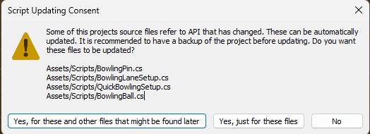
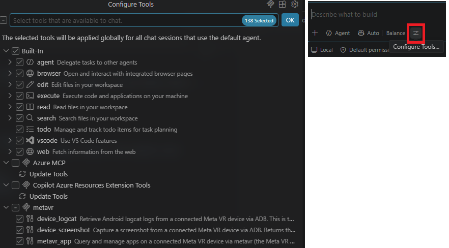

# Woche 4: Aufgabenbesprechung Bowling und Unity mit KI

## Überblick

In der vierten Woche werden zunächst die Lösungen zur Aufgabe aus Woche 3 besprochen: Punktezählung und automatische Rückholung der Kugel. Anschließend steht die Frage im Mittelpunkt, wie KI-Werkzeuge die Entwicklung in Unity unterstützen können und wo ihre Grenzen liegen. Dafür werden ein Coding-Assistent in VS Code sowie MCP-Server für den Unity Editor und für die Meta-Quest-Entwicklung eingerichtet, in einer Live-Demo eingesetzt und anschließend in der eigenen Bowlingszene ausprobiert.

Als gemeinsames Ergebnis entstehen ein mit KI ergänzter Spielablauf im Bowling, eine neue, möglichst vollständig mit KI erstellte Szene und eine begründete Einschätzung von Nutzen und Grenzen der Werkzeuge.

**Umfang:** 4 h Praktikum + 2 h Betreutes Selbststudium.

Block 1 ca. 45–60 Minuten, Block 2 restliche Präsenzzeit.

Grundlage ist das eigene Bowlingprojekt aus Woche 3 einschließlich der Skripte aus der Aufgabe. Vor Beginn von Block 2 wird der aktuelle Stand **mit Git committet**, damit sich Änderungen durch KI-Werkzeuge jederzeit nachvollziehen und zurücknehmen lassen.

## Lernziele

Im Verlauf der Veranstaltung werden folgende Kompetenzen aufgebaut:

- Vergleich und Bewertung unterschiedlicher Lösungswege für Punktezählung und Rückholung hinsichtlich Kopplung, Erweiterbarkeit und Fehleranfälligkeit;
- Unterscheidung verschiedener Einsatzarten von KI in der Unity-Entwicklung (Erklären, Code erzeugen, Editor steuern, Assets generieren);
- Einrichtung eines Coding-Assistenten und von MCP-Servern in VS Code;
- zielgerichtetes Arbeiten mit KI: Kontext geben, Aufgaben zerlegen, Ergebnisse prüfen und testen;
- Erkennen typischer KI-Fehler wie veralteter oder erfundener APIs;
- nachvollziehbare Kennzeichnung des KI-Einsatzes.

## Block 1 – Besprechung der Aufgabe aus Woche 3

Grundlage ist die Aufgabe [Punktezählung und automatische Rückholung](../Woche_3/Woche_3.md#aufgabe-bis-woche-4--punktezählung-und-automatische-rückholung).

### Vorführung

Zwei bis drei Lösungen werden kurz im Headset mit Bildschirmübertragung vorgeführt. Die vorführenden Personen erläutern dabei ihren Lösungsweg und die Stellen, an denen es Schwierigkeiten gab.

### Teil 1 – `ScoreCounter`

Die Kernfrage bei der Punktezählung lautet: **Wie erfährt das Score-Skript, dass ein Pin umgefallen ist?** Dafür gibt es drei typische Lösungswege. Sie unterscheiden sich darin, *wer wen kennt* und *wann gezählt wird*.

**1. Direkter Aufruf am Score-Skript.** Der Pin meldet sich selbst, sobald er umgefallen ist, und erhöht den Score direkt. So ist es auch im Muster-Projekt umgesetzt:

```csharp
// in Pin.cs, HidePin()
ScoreScript.scoreValue += 1;
```

Das ist schnell geschrieben und gut nachvollziehbar. Der Pin ist damit aber fest an das Score-Skript gebunden: Fehlt `ScoreScript` in einer Szene, kompiliert bzw. funktioniert der Pin nicht mehr, und soll beim Umfallen zusätzlich ein Sound oder eine Anzeige ausgelöst werden, muss jedes Mal `Pin.cs` geändert werden.

**2. Ereignis am Pin** (`event` bzw. `UnityEvent`). Der Pin verkündet nur „Ich bin umgefallen“, ohne zu wissen, wer zuhört. Das Score-Skript meldet sich bei allen Pins als Zuhörer an:

```csharp
// in Pin.cs
public event System.Action<Pin> Toppled;
// in HidePin(): Toppled?.Invoke(this);

// in ScoreCounter.cs
foreach (var pin in pinGroup.GetComponentsInChildren<Pin>())
    pin.Toppled += OnPinToppled;
```

Der Pin kennt das Score-Skript nicht mehr (**lose Kopplung**). Weitere Zuhörer wie Audio oder Haptik lassen sich ergänzen, ohne den Pin anzufassen. Bei einem `UnityEvent` geht das sogar ohne Code im Inspector. Dafür ist etwas mehr Aufbau nötig, und Zuhörer sollten sich in `OnDisable()` wieder abmelden (`-=`).

**3. Abfrage aller Pins.** Kein Pin meldet etwas. Stattdessen schaut das Score-Skript zu einem festen Zeitpunkt, z. B. einige Sekunden nach dem Wurf, alle Pins der `PinGroup` an und zählt die umgefallenen:

```csharp
int fallen = 0;
foreach (var pin in pinGroup.GetComponentsInChildren<Pin>(true))
    if (!pin.gameObject.activeSelf) fallen++;
```

Die Zählung liegt an einer einzigen Stelle, und Mehrfachzählung ist ausgeschlossen, weil jedes Mal neu gezählt statt aufaddiert wird. Dafür muss feststehen, *wann* gezählt wird; der Score aktualisiert sich nicht mehr sofort beim Umfallen. Achtung: Ausgeblendete Pins findet `GetComponentsInChildren` nur mit dem Parameter `true`.

| Lösungsweg | Wer kennt wen? | Wann wird gezählt? | Vorteil | Nachteil |
|---|---|---|---|---|
| **Direkter Aufruf** | Pin kennt Score-Skript | Sofort beim Umfallen | Einfach, wenig Code | Feste Abhängigkeit; Erweiterungen erfordern Änderungen am Pin |
| **Ereignis am Pin** | Score-Skript kennt Pins | Sofort beim Umfallen | Lose Kopplung; weitere Zuhörer leicht ergänzbar | Mehr Aufbau; An- und Abmelden beachten |
| **Abfrage aller Pins** | Score-Skript kennt Pins | Zu einem festen Zeitpunkt | Zählung an einer Stelle; keine Mehrfachzählung | Zeitpunkt muss festgelegt werden; keine Sofortanzeige |

Leitfrage für die Diskussion: Welcher Weg passt am besten, wenn in Woche 5 beim Umfallen zusätzlich ein Geräusch abgespielt und in Block 2 ein `GameManager` den Wurf auswerten soll?

Falls noch Zeit ist, werden außerdem besprochen:

**Mehrfachzählung:** `CheckRotation()` wird über `InvokeRepeating` einmal pro Sekunde aufgerufen. Wie wurde verhindert, dass ein Pin mehrfach gemeldet wird?

> **Erklärung**
>
> Nach einem Treffer prüft `CheckRotation()` bis zu `tries`-mal im Sekundentakt, ob der Pin gekippt ist. Ein umgefallener Pin bleibt umgefallen, daher ist die Prüfung bei jedem Durchlauf erneut erfüllt, und jedes Mal wird `HidePin()` nach `toppleLife` Sekunden eingeplant. Ohne Vorkehrung wird derselbe Pin also mehrfach gezählt. Zusätzlich kann ein Pin mehrfach getroffen werden (Kugel, Nachbarpins), und jeder Treffer startet die Prüfung neu.
>
> Mögliche Vorkehrungen:
>
> | Vorkehrung | Umsetzung |
> |---|---|
> | **Merker im Pin** | `bool counted`; nur melden, wenn `counted` noch `false` ist, danach auf `true` setzen |
> | **Sichtbarkeit prüfen** (Muster-Projekt) | In `HidePin()` nur zählen, wenn `gameObject.activeSelf` noch `true` ist; der erste Aufruf blendet den Pin aus |
> | **Prüfung beenden** | Nach der ersten Erkennung `CancelInvoke("CheckRotation")` aufrufen |
> | **Menge im Score-Skript** | Gemeldete Pins in einem `HashSet<Pin>` sammeln; der Score ist dessen Anzahl |
> | **Neu zählen statt aufaddieren** | Siehe Lösungsweg 3: Bei jeder Auswertung wird von null an gezählt |
>
> Wichtig ist, dass ein Merker beim Neustart der Pin-Aufstellung wieder zurückgesetzt wird. Sonst zählt ein Pin im zweiten Wurf nicht mehr.

**Wackelnder Pin:** Ab welcher Neigung gilt ein Pin als umgefallen, und wie wird ein Pin behandelt, der nur wackelt und stehen bleibt?

> **Erklärung**
>
> **Wie prüft `Pin.cs`?** Die Prüfung vergleicht die aktuelle Rotation mit der Startrotation über das Skalarprodukt zweier Quaternionen:
>
> ```csharp
> Mathf.Abs(Mathf.Abs(Quaternion.Dot(defaultRotation, transform.localRotation)) - 1f) > pinFallThreshold
> ```
>
> Das Skalarprodukt ist `cos(θ/2)`, wobei θ der Drehwinkel zwischen beiden Rotationen ist. Mit `pinFallThreshold = 0.02` gilt ein Pin ab `cos(θ/2) < 0,98` als gekippt, also ab einem Drehwinkel von etwa **23°**.
>
> **Schwächen dieser Prüfung:**
>
> - **Drehung um die eigene Achse zählt mit.** Der Vergleich misst jede Abweichung von der Startrotation, nicht nur die Neigung. Ein Pin, der sich stehend um mehr als 23° um seine Hochachse dreht, gilt ebenfalls als gekippt.
> - **Momentaufnahme.** `CheckRotation()` prüft einmal pro Sekunde. Ist der Pin genau in diesem Moment beim Wackeln stark geneigt, wird `HidePin()` eingeplant. `HidePin()` prüft nicht noch einmal, ob der Pin inzwischen wieder steht. Ein wackelnder Pin kann so fälschlich gezählt und ausgeblendet werden.
>
> **Robustere Kriterien:**
>
> - **Neigung gegenüber der Weltvertikalen** statt Vergleich der gesamten Rotation:
>
>   ```csharp
>   bool isDown = Vector3.Angle(transform.up, Vector3.up) > 45f;
>   ```
>
>   Die Drehung um die Hochachse spielt dann keine Rolle. Der Grenzwert (z. B. 30–60°) ist eine Gestaltungsentscheidung und sollte begründet werden.
> - **Erst nach Beruhigung auswerten:** Erst zählen, wenn der Pin zur Ruhe gekommen ist, z. B. über `rigidbody.IsSleeping()` oder eine sehr kleine `linearVelocity`. Eine maximale Wartezeit verhindert, dass ein ständig rollender Pin die Auswertung blockiert.
> - **Vor dem Ausblenden erneut prüfen:** In `HidePin()` die Neigung noch einmal prüfen und nur zählen, wenn der Pin weiterhin liegt.

**Score-Anzeige:** Canvas im Render Mode *World Space*; Platzierung, Größe und Lesbarkeit im Headset.

> **Erklärung**
>
> **Render Mode:** Ein Canvas im Standardmodus *Screen Space – Overlay* wird im Headset nicht angezeigt, weil es in VR keinen festen Bildschirm gibt. Mit *World Space* wird der Canvas zu einem Objekt im Raum mit Position, Rotation und Größe.
>
> **Größe und Maßstab:** Ein neuer World-Space-Canvas ist in Pixeln bemessen und dadurch zunächst riesig (z. B. 800 Einheiten breit = 800 m). Üblich ist ein Scale von `0.001`; dann entsprechen 1000 Canvas-Einheiten einem Meter, und die Größen lassen sich gut in Zentimetern denken.
>
> **Platzierung:** Mögliche Orte für die Anzeige:
>
> | Variante | Beispiel | Bewertung |
> |---|---|---|
> | **Diegetisch** | Anzeigetafel über den Pins wie in einer echten Bowlinghalle | Wirkt glaubwürdig und gehört zur Welt; muss aus der Wurfposition gut lesbar sein |
> | **Schwebendes Panel** | Panel seitlich neben der Bahn in Augenhöhe | Einfach umzusetzen; kann die Sicht auf die Bahn verdecken |
> | **Am Körper** | Anzeige am Handgelenk oder Controller | Immer verfügbar; muss aktiv angeschaut werden |
>
> Die Anzeige sollte nicht im Sichtfeld kleben (Head-locked). Das ist anstrengend und kann Unwohlsein auslösen.
>
> **Lesbarkeit:** Als Faustregel sollte die Schrifthöhe mindestens etwa 1° des Sichtwinkels einnehmen. In 2 m Entfernung entspricht das rund 3,5 cm; besser ist mehr. Zusätzlich:
>
> - ausreichender Kontrast, aber kein reines Weiß auf reinem Schwarz;
> - kurze Texte, z. B. nur „Score: 7“;
> - Canvas zur spielenden Person hin ausrichten.
>
> **Im Headset prüfen:** Die Wirkung im Editor täuscht. Größe, Entfernung und Kontrast werden erst auf der Quest zuverlässig beurteilt.

### Teil 2 – `BallReturn`

- Erkennung über die Trigger-Zone `PitZone` und Prüfung, ob das eintretende Objekt die Kugel ist (Komponente, Tag oder Layer `BowlingBall`);
- Wartezeit per `Invoke` oder Coroutine;
- Zurücksetzen von Position und Rotation sowie von `linearVelocity` und `angularVelocity`;
- Ausschluss einer gehaltenen Kugel;
- optional: Rückholung aus den Rinnen (`GutterZone_Left`, `GutterZone_Right`).

### Randfälle gemeinsam prüfen

| Randfall | Erwartetes Verhalten |
|---|---|
| Kugel wird in der `PitZone` gegriffen | Kein Zurücksetzen, solange sie gehalten wird |
| Kugel bleibt in der Rinne liegen | Rückholung nach Wartezeit (falls umgesetzt) |
| Pin fällt erst mehrere Sekunden nach dem Treffer | Wird trotzdem genau einmal gezählt |
| Mehrere Würfe hintereinander | Score und Rückholung funktionieren weiterhin |

### Überleitung

Zum Abschluss wird kurz erfasst, wo bei der Aufgabe bereits KI-Werkzeuge eingesetzt wurden und wie das im README vermerkt ist. Die Musterlösung steht im [Muster-Projekt](https://github.com/fschmidmichels/HSBI-xReality-Technologien-Unity) zur Verfügung.

## Block 2 – Unity mit KI verwenden

### Einordnung

KI-Werkzeuge lassen sich in der Unity-Entwicklung auf unterschiedliche Weise einsetzen:

| Einsatzart | Beispiel |
|---|---|
| **Fragen und Erklären** | Fehlermeldung aus der Console erklären lassen; Unterschied zwischen Trigger und Collider nachfragen |
| **Code erzeugen und überarbeiten** | Skript für einen Spielablauf schreiben lassen; vorhandenes Skript umbauen |
| **Editor steuern** (Agent mit MCP) | GameObjects anlegen, Komponenten setzen, Play Mode starten |
| **Assets generieren** | Texturen, Materialien, Sounds oder einfache Modelle |
| **Quest steuern** | APK auf das Headset übertragen, Status des Headsets abfragen, XR-Anwendung fernsteuern |

Typische Fehlerquellen:

- **veraltete oder erfundene APIs**, z. B. `velocity` statt `linearVelocity` (seit Unity 6) oder ältere OVR-Komponenten statt des Interaction SDK;

  

- **unpassende Paketversionen** oder Menüpfade, die es in der verwendeten Version nicht gibt;
- **Lösungen ohne XR-Bezug**, die im Editor funktionieren, aber nicht im Headset;
- **zu große Änderungen auf einmal**, die sich kaum prüfen lassen.

### Regeln für den KI-Einsatz in der Prüfung

Für die Prüfungen gelten die Regeln aus den [Prüfungsaufgaben, Abschnitt 5 – Eigenständigkeit und Hilfsmittel](../Pruefung/Pruefungsaufgaben.md#5-eigenständigkeit-und-hilfsmittel). KI-Werkzeuge dürfen unterstützend eingesetzt werden; Verwendung und Umfang werden im README in einer kompakten Tabelle dokumentiert (Quelle/Werkzeug, Verwendung, betroffene Bestandteile, eigene Anpassung und Prüfung).

Das gilt auch für die Einzelprüfung (Teil 1): KI darf dort ebenfalls eingesetzt werden, auch für die aufgabenspezifische Zuordnungs-, Fortschritts- und Resetlogik. Voraussetzung ist, dass der Einsatz gekennzeichnet ist und der abgegebene Code vollständig erklärt werden kann.

### Datenschutz und Sicherheit

- Keine persönlichen Daten, Zugangsdaten oder API-Keys in Prompts eingeben und nicht ins Repository übernehmen.
- Agenten mit Schreibzugriff (MCP) nur auf einem committeten Projektstand arbeiten lassen. Änderungen werden anschließend per Git-Diff geprüft.
- Das Git-Repository zusätzlich extern sichern, z. B. auf GitHub oder einem anderen Cloud-Dienst.
- Von der KI vorgeschlagene Terminal-Befehle vor dem Ausführen lesen und nur bestätigen, wenn klar ist, was sie bewirken.

### Anleitung 1 – KI in VS Code am Beispiel von GitHub Copilot

VS Code ist seit Woche 2 als externer Skripteditor eingerichtet. Mit GitHub Copilot lassen sich darin C#-Skripte für Unity schreiben, erklären und überarbeiten.

1. **Zugang:** GitHub-Account anlegen bzw. verwenden. Für Studierende ist Copilot über das [GitHub Student Developer Pack](https://education.github.com/pack) kostenlos verfügbar; daneben gibt es eine kostenlose Basisstufe mit begrenztem Kontingent.
2. **Erweiterung installieren:** In VS Code unter *Extensions* die Erweiterung **GitHub Copilot Chat** installieren und mit dem GitHub-Account anmelden.
3. **Unity-Projekt öffnen:** Den Projektordner (nicht nur ein einzelnes Skript) in VS Code öffnen, damit Copilot die übrigen Skripte als Kontext nutzen kann.
4. **Arbeitsweisen:**
   - *Inline-Vorschläge* beim Tippen mit `Tab` übernehmen;
   - *Chat* (`Strg+Alt+I`) für Fragen und Erklärungen; markierter Code oder Dateien werden mit `#` als Kontext angehängt;
   - *Agent-Modus* im Chat für Änderungen über mehrere Dateien; Änderungen werden vor dem Übernehmen als Diff angezeigt.
5. **Projektkontext hinterlegen:** In `AGENTS.md` werden dauerhafte Hinweise für Copilot und andere Agenten abgelegt (siehe [Anleitung 4](#anleitung-4--der-ki-den-kontext-und-die-mcp-server-bekannt-machen)).

Weiterführend: [GitHub Copilot in VS Code](https://code.visualstudio.com/docs/copilot/overview).

### Anleitung 2 – Unity CLI und Unity-MCP-Server

Die **Unity CLI** (`unity`) ist ein Kommandozeilenwerkzeug von Unity. Sie verwaltet Editor-Versionen und Projekte, startet Builds und Tests und kann einen **laufenden Unity Editor steuern**: GameObjects anlegen, Komponenten setzen, die Hierarchie auslesen oder den Play Mode starten. Über den eingebauten **MCP-Server** (Model Context Protocol) stehen diese Funktionen auch KI-Agenten zur Verfügung, z. B. Copilot im Agent-Modus. Die CLI befindet sich derzeit noch im Beta-Stadium. Die Anleitung bezieht sich auf Windows.

1. **Installieren** (PowerShell):

   ```powershell
   $env:UNITY_CLI_CHANNEL='beta'; irm https://public-cdn.cloud.unity3d.com/hub/prod/cli/install.ps1 | iex
   ```

   Danach ein neues Terminal öffnen und mit `unity --version` prüfen.

2. **Projekt verbinden:** Damit die CLI den Editor steuern kann, braucht das Projekt das Paket `com.unity.pipeline`. Im Projektordner ausführen:

   ```powershell
   unity pipeline install
   ```

   Anschließend den Editor mit dem Projekt öffnen und mit `unity status` prüfen, ob er als *ready* angezeigt wird.

3. **MCP in VS Code einbinden:** Im Projektordner ausführen:

   ```powershell
   unity mcp configure vscode --local
   ```

   Dadurch wird der Unity-MCP-Server projektbezogen in die VS-Code-Konfiguration eingetragen. Mit `--dry-run` lässt sich vorher anzeigen, was geschrieben würde. In VS Code erscheinen die Unity-Werkzeuge danach im Copilot-Chat (Agent-Modus) unter *Tools*.

4. **Telemetrie:** Nutzungsstatistiken sind standardmäßig deaktiviert (prüfen mit `unity analytics status`). Abschalten der Telemetrie geht mit `unity analytics opt-out`. (Zusätzlich lassen sich anonyme Fehlerberichte mit der Umgebungsvariable `UNITY_NO_CRASH_REPORT` und der anonyme Aufruf-Ping mit `UNITY_NO_CLI_INVOKED_TELEMETRY=1` abschalten.)

**Hinweis:** Hat das Projekt Compile-Fehler, startet Unity im *Safe Mode*. Das Pipeline-Paket wird dann nicht geladen, und der Agent kann den Editor nicht erreichen. Zuerst die Compile-Fehler beheben.

### Anleitung 3 – Meta VR CLI und Meta-MCP-Server

Die **Meta VR CLI** (`metavr`) ist das offizielle Entwicklerwerkzeug von Meta für die Quest-Entwicklung. Über ihren MCP-Server kann ein KI-Agent unter anderem:

- die aktuelle **Meta-Entwicklerdokumentation** und API-Referenz durchsuchen (wichtig, weil KI-Modelle bei Namen aus dem Meta SDK oft veraltet sind);
- angeschlossene **Quest-Geräte** verwalten, APKs installieren und starten, Logs lesen und Screenshots aufnehmen;
- Performance-Messungen aufzeichnen und auswerten.

1. **Installieren** (PowerShell):

   ```powershell
   iwr -useb https://developers.meta.com/horizon/install-cli/windows/ | iex
   ```

   Alternativ mit Node.js: `npx metavr@latest init`. Danach ein neues Terminal öffnen und mit `metavr --version` prüfen. `metavr doctor` zeigt, welche Entwicklerwerkzeuge (Android SDK, Unity-Editoren usw.) gefunden wurden.

2. **MCP in VS Code einbinden:** Entweder die geführte Einrichtung starten:

   ```powershell
   metavr init --no-auth
   ```

   oder nur den MCP-Server eintragen:

   ```powershell
   metavr mcp install vscode
   ```

   `metavr init` installiert zusätzlich Agent-Skills (Anleitungen für den Agenten) und fragt nach der Telemetrie-Einwilligung. Eine Anmeldung mit Meta-Account ist für den Kurs nicht erforderlich (`--no-auth`).

   **Andere Editoren und Agenten:** Wer nicht mit VS Code arbeitet, ersetzt `vscode` durch das passende Ziel, z. B. `metavr mcp install zed`. Die vollständige Liste zeigt `metavr mcp install --help`:

   | Ziel | Werkzeug |
   |---|---|
   | `vscode` | VS Code (per Deep Link; mit `--file` stattdessen über `mcp.json`) |
   | `vscode-insiders` | VS Code Insiders (per Deep Link) |
   | `cursor` | Cursor |
   | `zed` | Zed |
   | `windsurf` | Windsurf (Codeium) |
   | `antigravity` | Google Antigravity |
   | `android-studio` | Android Studio (Gemini-MCP-Server) |
   | `claude-desktop` | Claude Desktop |
   | `claude-code` | Claude Code CLI (zeigt den passenden Befehl an) |
   | `codex` | OpenAI Codex CLI (TOML-Konfiguration) |
   | `gemini-cli` | Gemini CLI |
   | `open-code` | OpenCode |
   | `muse-code` (Alias `muse`) | Muse Code, Metas eigene Coding-Umgebung |
   | `lm-studio` | LM Studio (per Deep Link) |
   | `project` | Projektordner: legt eine `mcp.json` bzw. `.mcp.json` im aktuellen Verzeichnis an |

3. **Telemetrie abstellen:**

   ```powershell
   metavr telemetry status
   metavr telemetry disable
   ```

   `disable` schaltet die zusätzliche Datenerhebung ab; laut Meta bleibt nur essenzielle Telemetrie aktiv. Details zeigt `metavr telemetry about`. (Beim Dozenten kam leider immer eine Fehlermeldung "Telemetry settings are managed remotely".)

Weiterführend: [Install Meta VR CLI](https://developers.meta.com/vr/essentials/metavr-install) und [Prompting best practices](https://developers.meta.com/vr/essentials/ai-prompting-best-practices).

### Anleitung 4 – Der KI den Kontext und die MCP-Server bekannt machen

Ein eingerichteter MCP-Server stellt Werkzeuge bereit. Ob und wie der Agent sie sinnvoll nutzt, hängt vom Kontext ab.

1. **Werkzeuge aktivieren:** MCP-Werkzeuge stehen nur im **Agent-Modus** zur Verfügung, nicht im reinen Fragemodus.
   - Im Chat unten im Eingabefeld **Agent** auswählen und auf **Configure Tools** (Werkzeug-Symbol) klicken. In der Liste prüfen, dass die Werkzeuge von Unity und `metavr` angehakt sind. Ganze Server oder einzelne Werkzeuge lassen sich dort an- und abwählen.
   - Alternativ über die Befehlspalette (`Strg+Umschalt+P`) **Chat: Open Customizations** aufrufen. Unter **Tools** werden Werkzeuge an- und abgewählt, unter **MCP Servers** lassen sich ganze Server deaktivieren.
   - Die Werkzeuge eines Servers erscheinen erst, wenn er erfolgreich gestartet ist. Server starten automatisch, sobald eine Anfrage sie braucht.

   

   Mehr Informationen: [VS Code-Dokumentation – Use tools with agents](https://code.visualstudio.com/docs/chat/chat-tools)

   **Wo die Server eingetragen sind:**

   | Datei | Geltungsbereich | Format |
   |---|---|---|
   | `.mcp.json` im Projektordner | nur dieses Projekt; auch von anderen Copilot-Werkzeugen lesbar | Schlüssel `mcpServers` |
   | `%USERPROFILE%\.copilot\mcp-config.json` | global für alle Projekte | Schlüssel `mcpServers` |
   | `.vscode/mcp.json` im Projektordner | nur dieses Projekt; VS-Code-eigenes Format, in der Einrichtung als *deprecated* markiert, funktioniert aber weiterhin | Schlüssel `servers` |
   | `%APPDATA%\Code\User\mcp.json` | global, VS-Code-eigenes Format, ebenfalls als *deprecated* markiert | Schlüssel `servers` |

   Welche Datei `unity mcp configure vscode` schreibt, zeigt vorher die Option `--dry-run`. `metavr mcp install vscode` trägt den Server standardmäßig per Deep Link direkt in VS Code ein, mit `--file` stattdessen in eine `mcp.json`. Ausführliche Anleitung: [Add and manage MCP servers in VS Code](https://code.visualstudio.com/docs/agent-customization/mcp-servers) und [MCP configuration reference](https://code.visualstudio.com/docs/agents/reference/mcp-configuration).

2. **Projektanweisungen anlegen:** In einer Datei `AGENTS.md` im Projektordner werden dauerhafte Informationen hinterlegt, die Agenten bei jeder Anfrage berücksichtigen, z. B. Unity-Version, XR-Stack, Konventionen und vorhandene Skripte.

   Beispiel aus dem Muster-Projekt: [AGENTS.md](https://github.com/fschmidmichels/HSBI-xReality-Technologien-Unity/blob/Wintersemester-2026/2027/AGENTS.md)

   **Achtung:** Nicht jeder Agent liest `AGENTS.md` automatisch. Claude Code etwa erwartet eine Datei `CLAUDE.md`. Darin genügt ein Verweis auf die gemeinsame Datei:

   ```markdown
   @AGENTS.md
   ```

3. **Agent-Skills:** `metavr init` und `unity skill install vscode --local` legen zusätzliche Anleitungen für den Agenten ab, etwa zum Umgang mit dem Editor oder mit der Quest.
4. **Im Prompt konkret werden:** Werkzeug ausdrücklich nennen, z. B. „Suche in der Meta-Dokumentation, wie …“ oder „Lege im laufenden Editor ein GameObject … an“.

### Live-Demo – GameManager mit KI

In der Demo wird mit einem KI-Werkzeug ein `GameManager` für das Bowling ergänzt. Er legt fest, in welcher Phase sich das Spiel befindet, und bindet die vorhandenen Skripte `ScoreCounter` und `BallReturn` ein, statt deren Logik neu zu schreiben.

| Zustand | Was passiert | Übergang |
|---|---|---|
| **Bereit** | Pins stehen, Kugel liegt auf der Ablage | Kugel wird gegriffen und losgelassen → *Wurf läuft* |
| **Wurf läuft** | Kugel rollt, Pins fallen | Kugel erreicht `PitZone` bzw. Rinne oder Maximalzeit abgelaufen → *Auswertung* |
| **Auswertung** | Warten, bis die Pins ruhig sind; umgefallene Pins von `ScoreCounter` abfragen; Score anzeigen | Nach wenigen Sekunden → *Neustart* |
| **Neustart** | Pins zurücksetzen (Position, Rotation, Geschwindigkeit), Kugel zurück auf die Ablage | → *Bereit* |

Möglicher Einstiegsprompt:

> Unity 6000.3, Meta XR Interaction SDK. In meiner Szene gibt es `ScoreCounter.cs` und `BallReturn.cs` (angehängt). Schreibe einen `GameManager` mit den Zuständen Bereit, Wurf läuft, Auswertung und Neustart. Nutze die vorhandenen Skripte, statt ihre Logik zu duplizieren. Ein Wurf endet, wenn die Kugel die PitZone erreicht oder nach 10 s. Erkläre kurz, welche Änderungen an den bestehenden Skripten nötig sind.

An der Demo wird die Arbeitsweise sichtbar gemacht:

1. **Kontext geben:** Unity-Version, XR-Stack, vorhandene Skripte.
2. **Aufgabe zerlegen:** erst die Zustände, dann die Anbindung von `BallReturn`, dann die Auswertung.
3. **Ergebnis lesen:** Ist der Code verständlich? Werden die vorhandenen Skripte genutzt?
4. **Testen:** im Editor und auf der Quest, insbesondere mit den Randfällen aus Block 1.
5. **Fehler zurückmelden:** Fehlermeldung oder beobachtetes Fehlverhalten an die KI geben.
6. **Änderungen prüfen:** per Git-Diff.

### Übung in der eigenen Bowlingszene

Jede Person setzt eine klar begrenzte Erweiterung mit KI um, zum Beispiel:

- den `GameManager` mit der Zustandsfolge aus der Demo;
- Neustart der Pin-Aufstellung mit Reset von Position, Orientierung und Bewegungszustand;
- Anzeige „Strike“ bzw. „Kein Treffer“;
- Variation der Physics Materials von Bahn und Kugel.

**Prüfen statt übernehmen:** Jede Person erklärt der Nachbarperson den erzeugten Code und testet die Randfälle aus Block 1.

## 2 h BS – Neue Szene komplett mit KI gestalten

In der BS-Phase wird in einer **neuen Szene** eine kleine XR-Erfahrung möglichst vollständig mit KI-Werkzeugen erstellt, z. B.:

- Dosenwerfen;
- Basketballkorb;
- Zielscheibe;
- ein Raum mit interaktiven Objekten.

Umgebung, Objekte, Interaktion und Logik werden per Prompt bzw. Agent erzeugt. Eigene Eingriffe beschränken sich möglichst auf Prompts, Tests und Rückmeldung von Fehlern. Das Thema unterscheidet sich bewusst von der Einzelprüfung: **keine Zuordnungsaufgabe mit Zielbereichen**.

1. **Szene anlegen** und den Stand vorher committen.
2. **Idee in einem Satz formulieren** und als Ausgangsprompt verwenden.
3. **Schrittweise aufbauen:** Umgebung, greifbare Objekte, Spiellogik, Feedback.
4. **APK bauen** und auf der Quest 3 testen. Ziel ist ein lauffähiger Stand.
5. **Gegenseitig ausprobieren** und vergleichen: Was gelang schnell, wo musste nachgearbeitet werden, wo war Handarbeit schneller?

## Vor- und Nachbereitung außerhalb der Präsenz (optional)

Zur KI-Szene wird eine kurze Reflexion (ca. eine halbe Seite) mit folgenden Bestandteilen verfasst:

- eingesetzte Werkzeuge;
- gelungene und gescheiterte Schritte;
- gefundene Fehler und eigene Korrekturen;
- Einschätzung: Wofür lohnt sich KI im eigenen Projekt, wofür nicht?

Der KI-Einsatz in der Bowlingszene und in der KI-Szene wird im README gekennzeichnet (siehe [Regeln für den KI-Einsatz in der Prüfung](#regeln-für-den-ki-einsatz-in-der-prüfung)).

## Ergebnis der Woche

Zum Abschluss werden folgende Ergebnisse zusammengeführt:

- besprochene und gegebenenfalls korrigierte Punktezählung und Rückholung;
- eingerichteter Coding-Assistent sowie Unity- und Meta-MCP-Server in VS Code;
- mit KI ergänzter Spielablauf im Bowling;
- eine begonnene, mit KI erstellte Szene (Fertigstellung bis Woche 5);
- optional: Reflexion zu Nutzen und Grenzen der KI-Werkzeuge;
- Kennzeichnung des KI-Einsatzes im README.

## Aufgabe bis Woche 5 – KI-Szene fertigstellen

Die in der BS-Phase begonnene KI-Szene wird bis Woche 5 fertiggestellt und zu Beginn von Woche 5 kurz vorgestellt.

### Vorstellung in Woche 5

Pro Person stehen **ca. 3 Minuten** zur Verfügung, live im Headset mit Bildschirmübertragung oder als kurzer Videoclip. Dabei wird beantwortet:

1. Was ist die Idee der Szene?
2. Welche KI-Werkzeuge wurden eingesetzt?
3. Was gelang schnell, und wo musste nachgearbeitet werden?
4. Wo lag die KI falsch, und woran wurde das erkannt?
