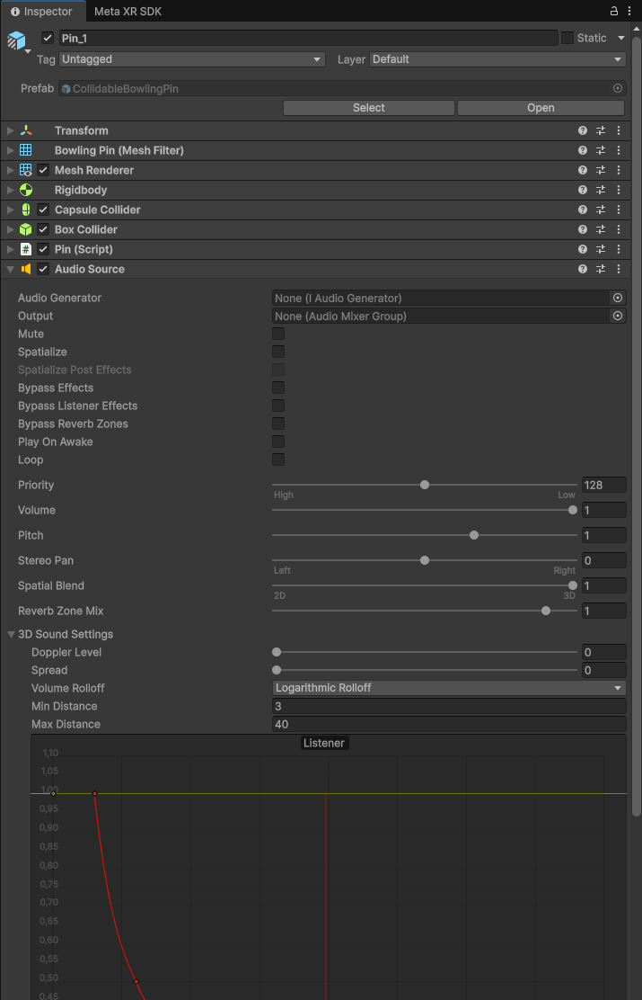
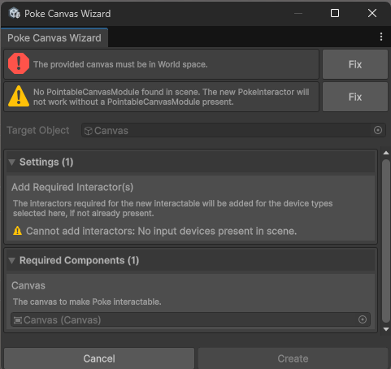
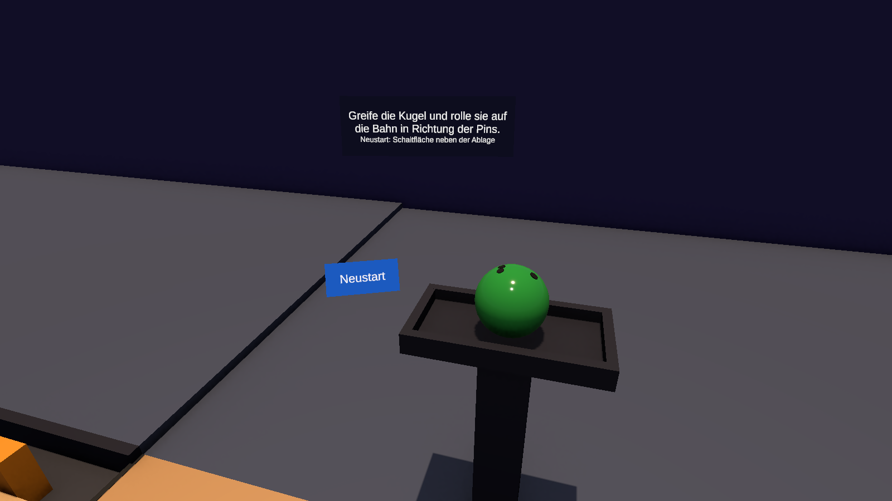
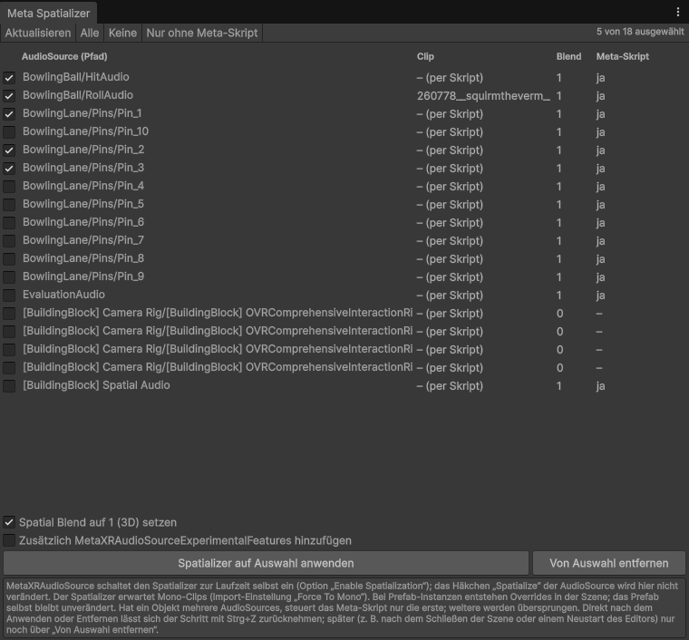

# Woche 5: Immersion durch Feedback, Audio und räumliches UI

## Überblick

In der fünften Woche werden zunächst die mit KI erstellten Szenen aus Woche 4 vorgestellt. Danach geht es um die Rückmeldungen der Bowlingszene: Was muss eine Person im Headset in welchem Moment erfahren, und über welchen Kanal erfährt sie es am besten? Auf eine kurze Bestandsaufnahme auf Papier folgen räumliches Audio, ein haptischer Impuls beim Greifen und ein bedienbares UI im Raum.

Als gemeinsames Ergebnis entsteht ein Bowling-Prototyp mit abgestimmtem multimodalem Feedback, der auch ohne mündliche Erklärung verstanden wird.

**Umfang:** 4 h Praktikum + 2 h Betreutes Selbststudium.

Grundlage ist das eigene Bowlingprojekt mit Punktezählung, Rückholung und dem Spielablauf aus Woche 4. Für Block 3 wird ein Paket mit Sounds bereitgestellt (siehe [Bereitgestellte Sounds](#bereitgestellte-sounds)). Vor Beginn wird der aktuelle Stand **mit Git committet**. Andernfalls wird ein Klon von dem Musterprojekt von Woche 4 benutzt (siehe README).

## Lernziele

Im Verlauf der Veranstaltung werden folgende Kompetenzen aufgebaut:

- Bestimmung des Informationsbedarfs für die einzelnen Momente einer Interaktion;
- begründete Auswahl visueller, auditiver und haptischer Rückmeldungen;
- Einrichtung räumlicher Audioquellen und Kopplung von Geräuschen an physikalische Ereignisse;
- Auslösen eines haptischen Impulses am greifenden Controller;
- Gestaltung eines lesbaren und bedienbaren UI im Raum;
- Überprüfung der Wirkung von Rückmeldungen im Headset und mit anderen Personen, statt nur ihrer technischen Existenz.

## Block 1 – KI-generierte Szenen aus Woche 4

Die Szenen aus der [Aufgabe bis Woche 5](../Woche_4/Woche_4.md#aufgabe-bis-woche-5--ki-szene-fertigstellen) werden vorgestellt. Pro Person stehen **ca. 3 Minuten** zur Verfügung, live im Headset mit Bildschirmübertragung oder als kurzer Videoclip:

1. Was ist die Idee der Szene?
2. Welche KI-Werkzeuge wurden eingesetzt?
3. Was gelang schnell, und wo musste nachgearbeitet werden?
4. Wo lag die KI falsch, und woran wurde das erkannt?

Beim Zuschauen wird zusätzlich auf die Rückmeldungen geachtet: Woran ist in der Szene zu erkennen, dass etwas gegriffen, getroffen oder ausgelöst wurde? Die Beobachtungen leiten zu Block 2 über.

## Block 2 – Feedback-Inventur und Einstieg

Dieser Block findet ohne Unity statt (ca. 20–30 Minuten). Bevor Audio, Haptik und UI eingebaut werden, wird festgehalten, welche Rückmeldungen die eigene Bowlingszene braucht.

### Feedback-Inventur

Die Momente orientieren sich an der Zustandsfolge *Bereit → Wurf läuft → Auswertung → Neustart* aus Woche 4. Die ersten beiden Spalten sind vorgegeben, die übrigen werden für die eigene Szene ausgefüllt:

| Moment | Was muss die Person wissen? | Aktuell vorhanden? | Kanal (visuell / auditiv / haptisch) | Umsetzung in Block 3/4 |
|---|---|---|---|---|
| **Greifen** | Kann ich die Kugel greifen? Habe ich sie in der Hand? | | | |
| **Loslassen** | Ist sie losgelassen, war der Wurf gültig? | | | |
| **Kollision** | Was wurde getroffen und wie stark? | | | |
| **Auswertung** | Wie viele Pins sind gefallen? Ist die Zählung abgeschlossen? | | | |
| **Neustart** | Wann darf ich wieder werfen? Muss ich etwas tun? | | | |

Für die Spalte *Aktuell vorhanden?* wird die Szene kurz im Headset geprüft. Die Pins aus dem Paket von Woche 3 geben zum Beispiel bereits Geräusche von sich, wenn sie aneinanderstoßen.

### Kanäle auswählen

Nicht jede Rückmeldung braucht alle Kanäle. Jeder Kanal hat Stärken und Grenzen:

| Kanal | Geeignet für | Grenzen |
|---|---|---|
| **Haptisch** | Alles, was die Hand betrifft: Greifen, Loslassen | Nur mit Controllern; mit Hand-Tracking entfällt der Kanal. Für entfernte Ereignisse unplausibel. |
| **Auditiv** | Kurze Ereignisse, auch außerhalb des Blickfelds: Aufprall, Rollen, Rinne | Flüchtig; viele gleichzeitige Geräusche überlagern sich. |
| **Visuell** | Dauerhafte Zustände: Punktestand, „bereit für den nächsten Wurf“; Hervorhebung greifbarer Objekte | Wirkt nur, wenn die Person hinschaut. |

Leitfrage: Welche Rückmeldung fällt weg, wenn mit Hand-Tracking statt mit Controllern gespielt wird, und wodurch wird sie dann ersetzt?

### Einstieg ohne mündliche Erklärung

Eine fremde Person setzt das Headset auf. Woran erkennt sie, was zu tun ist, ohne dass jemand danebensteht und es erklärt? Der Einstieg wird skizziert, zum Beispiel mit:

- einer hervorgehobenen Kugel auf der Ablage;
- einer markierten Wurfposition;
- einem kurzen Hinweistext im Raum, der nach dem ersten Wurf verschwindet.

Der Entwurf wird in Block 4 umgesetzt und kann in der Nachbereitung getestet werden (optional, siehe [Onboarding-Test](#onboarding-test-optional)).

**Ergebnis des Blocks:** die ausgefüllte Tabelle als Arbeitsplan für Block 3 und 4 sowie eine Skizze des Einstiegs.

## Block 3 – Räumliches Audio

### Einleitung: Was macht einen Sound räumlich?

Im Alltag hört man, wo ein Geräusch herkommt, ohne hinzusehen. Das Gehör wertet dafür vor allem drei Hinweise aus:

- **Lautstärkeunterschied zwischen den Ohren:** Ein Geräusch von rechts ist am rechten Ohr lauter, weil der Kopf das linke Ohr abschattet.
- **Laufzeitunterschied zwischen den Ohren:** Der Schall erreicht das zugewandte Ohr Bruchteile einer Millisekunde früher.
- **Entfernung:** Entfernte Quellen sind leiser und klingen dumpfer; der Anteil des Raumhalls nimmt zu.

In VR kommt die **Kopfbewegung** hinzu: Dreht man den Kopf, muss das Geräusch an seinem Ort im Raum bleiben. Ein Sound, der sich mit dem Kopf mitdreht, wirkt wie aus dem Kopfhörer und nicht wie aus der Welt. Räumliches Audio trägt deshalb stark zur Präsenz bei. Außerdem lenkt es die Aufmerksamkeit auf Ereignisse außerhalb des Blickfelds, was kein visueller Hinweis leisten kann.

Unity erzeugt diese Hinweise zur Laufzeit: Aus der Position der Schallquelle und der Position und Ausrichtung des Kopfes wird in jedem Moment berechnet, was am linken und am rechten Ohr ankommt.

#### Warum Mono-Sounds?

Für räumliche Schallquellen werden **Mono-Sounds** verwendet, also Aufnahmen mit nur einem Kanal:

- **Eine Quelle, ein Signal.** Eine Kugel oder ein Pin ist eine punktförmige Schallquelle an genau einem Ort. Das Links-Rechts-Bild entsteht erst durch die Berechnung in der Engine und passt sich bei jeder Kopfbewegung an.
- **Stereo enthält schon ein fertiges Raumbild.** In einer Stereo-Aufnahme ist die Verteilung auf links und rechts fest eingebaut, z. B. ein Pin, der in der Aufnahme links fällt. Dieses Bild gilt nur für die Position des Mikrofons und widerspricht der Position der Quelle in der Szene.
- **Die Stereo-Information geht ohnehin verloren.** Bei einer 3D-Quelle legt Unity beide Kanäle an denselben Punkt im Raum. Der zweite Kanal bringt dann nichts mehr.
- **Spatializer setzen Mono voraus.** Die Dokumentation des Meta XR Audio SDK verlangt ausdrücklich, dass alle Sounds für den Spatializer mono sind (siehe [Hintergrund: Panning und Spatializer](#hintergrund-panning-und-spatializer)).
- **Halber Speicherbedarf.** Ein Mono-Clip braucht halb so viel Speicher wie derselbe Clip in Stereo. Auf der Quest zählt das.

Stereo bleibt sinnvoll für alles, was **keinen Ort** in der Szene hat, z. B. Hintergrundmusik oder eine allgemeine Raumatmosphäre. Solche Quellen werden mit *Spatial Blend* = 0 abgespielt.

Viele frei verfügbare Sounds sind Stereo-Aufnahmen, auch einige der bereitgestellten. In Unity lässt sich ein Clip ohne externes Programm umwandeln: Clip im Project-Fenster auswählen, im Inspector **Force To Mono** aktivieren und **Apply** wählen.

### Bereitgestellte Sounds

Im Ordner [`Assets für Unity`](Assets%20für%20Unity/) liegt das Paket **`XRT_Bowling_Woche5.unitypackage`**. Es wird über **Assets → Import Package → Custom Package…** importiert und ergänzt den Ordner `Assets/Bowling/Sounds`. Zusätzlich enthält es das Editor-Werkzeug `Assets/Bowling/Editor/SpatializerSetupWindow.cs` für die optionale Aufgabe in der BS-Phase (siehe [Werkzeug: Meta Spatializer einrichten](#werkzeug-meta-spatializer-einrichten)).

| Sound | Verwendung |
|---|---|
| Aufprall der Kugel auf die Pins | Pflichtteil dieses Blocks |
| Rollgeräusch (Loop) | Pflichtteil dieses Blocks |
| Bestätigung, Jubel, Klatschen, Enttäuschung | optionale Rückmeldung zur Auswertung |

Alle Sounds stammen von [freesound.org](https://freesound.org/) und stehen unter CC0. Die Quellen und Lizenzen jedes einzelnen Sounds sind in `Assets/Bowling/QUELLEN.md` aufgeführt und werden in das eigene README übernommen. Die Pin-Geräusche sind bereits seit dem Paket von Woche 3 im Projekt.

**Nach dem Import:** Alle räumlich verwendeten Sounds (Pin-Geräusche, Aufprall, Rollgeräusch) im Project-Fenster auswählen, im Inspector **Force To Mono** aktivieren und mit **Apply** bestätigen.

### Grundlagen: AudioSource und AudioListener

Ein Geräusch braucht in Unity zwei Komponenten: eine **AudioSource** als Quelle und einen **AudioListener** als „Ohr“. Der AudioListener sitzt an der Kamera des Camera Rigs und bewegt sich mit dem Kopf. Es darf nur einen aktiven AudioListener in der Szene geben.

Ob ein Geräusch räumlich wirkt, entscheiden die Einstellungen der AudioSource:

| Einstellung | Bedeutung | Empfehlung für das Bowling |
|---|---|---|
| **Spatial Blend** | 0 = 2D (überall gleich laut), 1 = 3D (Richtung und Entfernung hörbar) | 1 |
| **Volume Rolloff** | Wie die Lautstärke mit der Entfernung abnimmt (*Logarithmic*, *Linear*, *Custom*) | *Logarithmic* |
| **Min Distance** | Bis zu dieser Entfernung volle Lautstärke | ca. 1 m |
| **Max Distance** | Ab dieser Entfernung wird nicht weiter abgeschwächt | ca. 25 m (Bahnlänge) |
| **Play On Awake** | Spielt sofort beim Start | aus bei Ereignisgeräuschen, an beim Roll-Loop |
| **Loop** | Wiederholt den Clip | nur beim Roll-Loop |

Die Werte für Rolloff und Entfernung stehen im Inspector unter **3D Sound Settings**, die zunächst eingeklappt sind. Die Kurve darunter zeigt, wie die Lautstärke mit der Entfernung abnimmt; die rote senkrechte Linie markiert die aktuelle Entfernung zum AudioListener. Im Beispiel (Pin aus dem Muster-Projekt) ist *Min Distance* auf 3 m erhöht, damit die weit entfernten Pins laut genug bleiben.



### Hintergrund: Panning und Spatializer

Mit *Spatial Blend* = 1 berechnet Unity Richtung und Entfernung über einfaches **Panning**: Die Lautstärke wird zwischen linkem und rechtem Ohr verteilt und mit der Entfernung abgeschwächt. Links und rechts sind damit gut zu unterscheiden. Ob ein Geräusch aber vorn oder hinten, oben oder unten liegt, ist kaum zu hören.

Ein **Spatializer** geht weiter. Der **Meta XR Audio Spatializer** aus dem Meta XR Audio SDK (`com.meta.xr.sdk.audio`, Teil von `com.meta.xr.sdk.all`) filtert jedes Geräusch mit einer **HRTF** (*Head-Related Transfer Function*). Eine HRTF bildet nach, wie Kopf und Ohrmuscheln den Schall je nach Einfallsrichtung verändern. Dadurch wird auch hörbar, ob ein Geräusch von vorn, hinten, oben oder unten kommt. Zusätzlich bietet das SDK einfache Raumakustik mit frühen Reflexionen und Nachhall.

Voraussetzungen für den Spatializer:

- In **Edit → Project Settings → Audio** ist als **Spatializer Plugin** *Meta XR Audio* eingetragen.
- An der AudioSource ist *Spatial Blend* = 1, und der Spatializer ist für diese Quelle eingeschaltet: entweder über die Option **Spatialize** der AudioSource oder über die Komponente **Meta XR Audio Source** (Option **Enable Spatialization**), die **Spatialize** zur Laufzeit selbst setzt.
- Die Sounds sind **mono**. Stereo-Clips werden über die Import-Einstellung **Force To Mono** umgewandelt.

In Block 3 genügt das Panning von Unity. Den Spatializer auszuprobieren ist eine optionale Aufgabe in der BS-Phase (siehe [Optional für Schnelle – Meta XR Audio Spatializer](#optional-für-schnelle--meta-xr-audio-spatializer)).

Dokumentation: [Meta XR Audio SDK – Requirements and setup](https://developers.meta.com/horizon/documentation/unity/meta-xr-audio-sdk-unity-req-setup) und [Apply Spatialization in Unity](https://developers.meta.com/horizon/documentation/unity/meta-xr-audio-sdk-unity-spatialize).

### Pin-Geräusche untersuchen

Das Prefab `CollidableBowlingPin` aus Woche 3 enthält bereits eine AudioSource und das Skript `PinAudio.cs`. Es wird geöffnet und untersucht:

- Welches Ereignis löst das Geräusch aus?
- Wie wird aus der Aufprallgeschwindigkeit (`collision.relativeVelocity.magnitude`) die Lautstärke berechnet?
- Wozu dienen `minImpactSpeed` und `cooldown`? Was ist zu hören, wenn beide auf 0 gesetzt werden?
- Warum wird die Tonhöhe (`pitch`) bei jedem Anschlag leicht zufällig verändert?

Anschließend wird im Headset verglichen: **Spatial Blend** der Pins einmal auf 0 und einmal auf 1. Ist bei 1 zu hören, dass die Pins rund 18 m entfernt stehen? Ist das Geräusch dann noch laut genug?

### Geräusche der Kugel: `BallAudio` einrichten und untersuchen

Im Ordner `Assets/Bowling/Scripts` liegt seit dem Paket von Woche 3 das Skript `BallAudio.cs`. Es erzeugt zwei Geräusche der Kugel: den **Aufprall** auf die Pins und das **Rollen** auf der Bahn. Das Skript wird nicht neu geschrieben, sondern an der eigenen Kugel eingerichtet und anschließend untersucht.

Die beiden Geräusche stehen für zwei Grundmuster:

| Muster | Beispiel | Umsetzung |
|---|---|---|
| **Ereignis** | Aufprall auf die Pins | einmaliges Abspielen im Moment der Kollision (`PlayOneShot`) |
| **Zustand** | Rollen auf der Bahn | Loop, der dauerhaft läuft; Lautstärke und Tonhöhe werden in jedem Frame angepasst |

#### Einrichten

1. Das Kugel-Prefab wird geöffnet. Unter der Kugel werden zwei leere Kindobjekte angelegt, `RollAudio` und `HitAudio`, jeweils mit einer **AudioSource**.
2. Die beiden AudioSources werden eingestellt:

| Einstellung | `RollAudio` | `HitAudio` |
|---|---|---|
| **AudioClip** | Rollgeräusch (Loop) aus dem Paket | leer |
| **Play On Awake** | an | aus |
| **Loop** | an | aus |
| **Volume** | 0 | 1 |
| **Spatial Blend** | 1 | 1 |

3. `BallAudio` wird an das Objekt der Kugel gehängt, das den **Rigidbody** trägt. Im Inspector werden `Roll Source`, `Hit Source` und als `Strike Clip` der Aufprall-Sound aus dem Paket zugewiesen.
4. Mit dem `TestImpulse` aus Woche 3 wird bei 3 m/s und bei 8 m/s geprüft, ob Rollen und Aufprall zu hören sind und ob sich die beiden Würfe hörbar unterscheiden.

**Wichtig:** Alle drei Felder müssen zugewiesen sein. Fehlt eine der beiden AudioSources, erscheint in der Console eine `NullReferenceException`; ohne `Strike Clip` bleibt der Aufprall stumm.

#### Aufprall untersuchen (`OnCollisionEnter`)

- Woran erkennt das Skript, ob die Kugel einen Pin oder die Bahn berührt hat?
- Wie wird aus der Aufprallgeschwindigkeit die Lautstärke berechnet? Was bewirkt der Zusatz `+ 0.3f`?
- Die Kugel trifft in kurzer Folge mehrere Pins. Was wäre ohne `strikeCooldown` zu hören, und warum ist die Sperrzeit hier viel länger als bei den Pins (0,05 s)?
- Im Vergleich zu `PinAudio`: Welche Absicherung gegen Kleinstkollisionen fehlt in `BallAudio`? In welcher Situation wäre das hörbar?
- Am Anfang von `OnCollisionEnter` in `PinAudio.cs` wird geprüft, ob das andere Objekt `BallAudio` trägt. Was wäre ohne diese Prüfung zu hören?

#### Rollen untersuchen (`Update`, `OnCollisionStay`)

- Warum läuft das Rollgeräusch als Loop mit *Volume* 0, statt bei Bedarf gestartet und gestoppt zu werden?
- Woran erkennt das Skript den Bodenkontakt? Warum merkt es sich einen Zeitpunkt (`lastGroundContact`) und prüft ein Zeitfenster von 0,1 s, statt nur „berührt gerade / berührt nicht“ zu speichern?
- Wozu dient die Prüfung `!body.isKinematic`?
- Warum wird nur der horizontale Anteil der Geschwindigkeit verwendet (x und z, ohne y)?
- Welche Rolle spielen `minRollSpeed`, `fullVolumeSpeed`, `maxRollVolume`, `minPitch` und `maxPitch`?
- Wozu dient `Mathf.MoveTowards` bei der Lautstärke?

#### Ausprobieren

Die Antworten werden im Play Mode überprüft. Public Werte lassen sich dabei direkt im Inspector ändern; sie werden beim Beenden des Play Mode zurückgesetzt.

| Änderung | Beobachtung |
|---|---|
| `strikeCooldown` auf 0 | Wie klingt der Treffer in die Pins? |
| `minPitch` und `maxPitch` auf denselben Wert | Ist die Geschwindigkeit der Kugel noch zu hören? |
| `fullVolumeSpeed` auf 2 bzw. auf 20 | Wie verändern sich Rollen und Aufprall bei einem normalen Wurf? |
| *Spatial Blend* von `RollAudio` auf 0 | Ist noch zu hören, dass sich die Kugel entfernt? |

### Optional für Schnelle – `BallAudio` erweitern

Wer die Untersuchung abgeschlossen hat, kann das Skript gezielt verbessern:

- **Kleinstkollisionen:** eine Mindestgeschwindigkeit für den Aufprall ergänzen, nach dem Vorbild von `minImpactSpeed` in `PinAudio`.
- **Fehlende Zuweisungen:** das Skript so absichern, dass eine fehlende AudioSource keine `NullReferenceException` auslöst, sondern einmalig eine verständliche Warnung ausgibt.
- **Rinne:** In der Rinne klingt das Rollen anders als auf der Bahn. Wie könnte das Skript den Untergrund unterscheiden (z. B. über Tag oder Physics Material) und Tonhöhe oder Clip anpassen?

### Optional – Rückmeldung zur Auswertung

Mit den übrigen Sounds aus dem Paket lässt sich das Ende der Auswertung hörbar machen: eine kurze Bestätigung nach jeder Auswertung, dazu Jubel bei einem Strike oder ein enttäuschtes „Aww“, wenn kein Pin gefallen ist. Ausgelöst wird das Geräusch beim Wechsel in den Zustand *Auswertung* bzw. *Neustart* des eigenen `GameManager`. Die AudioSource wird an der Anzeigetafel oder über den Pins platziert, damit das Geräusch aus der Spielwelt kommt.

## Block 4 – Haptik und räumliches UI

### Haptischer Impuls beim Greifen

Beim Greifen der Kugel vibriert der greifende Controller kurz. Die einfachste Schnittstelle dafür ist `OVRInput.SetControllerVibration(frequency, amplitude, controller)`:

- `amplitude` liegt zwischen 0 und 1 und bestimmt die Stärke;
- `frequency` wird auf 1 gesetzt und hat keinen weiteren Einfluss;
- die Vibration hält an, bis sie mit `amplitude` = 0 beendet wird (spätestens nach 2 Sekunden).

Das Skript muss wissen, **welcher** Controller greift. Die Kugel meldet den greifenden Interactor über zwei Interactables unter `GrabInteraction`: das *Grab Interactable* und das *Hand Grab Interactable*. Das Rig kann auch mit Controllern über die „Hand im Controller“ greifen; dann meldet sich nur das *Hand Grab Interactable*. Deshalb hört das Skript auf beide und sucht vom Interactor aus den zugehörigen Controller:

```csharp
using System.Collections;
using Oculus.Interaction;
using Oculus.Interaction.HandGrab;
using Oculus.Interaction.Input;
using UnityEngine;

// Kurzer haptischer Impuls am greifenden Controller, sobald die Kugel gegriffen wird.
// Hört auf GrabInteractable und HandGrabInteractable, weil das Comprehensive Interaction Rig
// auch mit Controllern über controllergesteuerte Hände greifen kann.
// Bei Hand-Tracking ist kein Controller verbunden; dann gibt es keinen Impuls.
public class GrabHaptics : MonoBehaviour
{
    [Range(0f, 1f)]
    [Tooltip("Stärke der Vibration.")]
    public float amplitude = 0.6f;

    [Min(0.01f)]
    [Tooltip("Dauer des Impulses in Sekunden.")]
    public float duration = 0.2f;

    private GrabInteractable grabInteractable;
    private HandGrabInteractable handGrabInteractable;

    protected void Awake()
    {
        grabInteractable = GetComponentInChildren<GrabInteractable>();
        handGrabInteractable = GetComponentInChildren<HandGrabInteractable>();
    }

    protected void OnEnable()
    {
        if (grabInteractable != null)
        {
            grabInteractable.WhenSelectingInteractorViewAdded += OnGrabbed;
        }
        if (handGrabInteractable != null)
        {
            handGrabInteractable.WhenSelectingInteractorViewAdded += OnGrabbed;
        }
    }

    protected void OnDisable()
    {
        if (grabInteractable != null)
        {
            grabInteractable.WhenSelectingInteractorViewAdded -= OnGrabbed;
        }
        if (handGrabInteractable != null)
        {
            handGrabInteractable.WhenSelectingInteractorViewAdded -= OnGrabbed;
        }
    }

    private void OnGrabbed(IInteractorView interactorView)
    {
        // Vom greifenden Interactor aus den Controller (links/rechts) im Rig suchen.
        MonoBehaviour interactor = interactorView as MonoBehaviour;
        if (interactor == null)
        {
            return;
        }

        ControllerRef controller = interactor.GetComponentInParent<ControllerRef>();
        if (controller == null || !controller.IsConnected)
        {
            return;
        }

        OVRInput.Controller touch = controller.Handedness == Handedness.Left
            ? OVRInput.Controller.LTouch
            : OVRInput.Controller.RTouch;

        StartCoroutine(Pulse(touch));
    }

    private IEnumerator Pulse(OVRInput.Controller touch)
    {
        OVRInput.SetControllerVibration(1f, amplitude, touch);
        yield return new WaitForSeconds(duration);
        OVRInput.SetControllerVibration(1f, 0f, touch);
    }
}
```

1. Das Skript wird an das Kugel-Prefab gehängt.
2. Im Headset werden Stärke und Dauer variiert, z. B. 0,3 / 0,6 / 1,0 und 0,05 s / 0,1 s / 0,3 s.
3. Es wird festgehalten, welche Kombination als „Zugreifen“ empfunden wird und ab wann der Impuls stört.

Leitfragen:

- Vibriert tatsächlich nur der greifende Controller?
- Mit Hand-Tracking gibt es keinen Controller und damit keine Haptik. Welche Rückmeldung aus der Tabelle in Block 2 übernimmt dann?

Weiterführend: Für aufwendigere Effekte gibt es das Haptics SDK und Haptics Studio von Meta, siehe [Other haptic runtime APIs](https://developers.meta.com/vr/documentation/unity/unity-haptics-apis) und die Vorstellung zum Building Block *Haptics* aus Woche 3.

### Punktestand lesbar platzieren

Die Score-Anzeige aus Woche 3 wird mit den Kriterien aus [Woche 4, Block 1](../Woche_4/Woche_4.md#teil-1--scorecounter) im Headset überprüft:

- Ist der Punktestand aus der Wurfposition ohne Kopfdrehung lesbar?
- Reicht die Schriftgröße auf die tatsächliche Entfernung (Faustregel: mindestens 1° Sichtwinkel, in 2 m rund 3,5 cm Schrifthöhe)?
- Verdeckt die Anzeige die Bahn oder die Pins?

### Neustart bedienbar machen

Für den Neustart wird eine Schaltfläche im Raum ergänzt, die mit dem Finger bzw. Controller gedrückt wird (*Poke*).

1. **Canvas anlegen:** Rechtsklick in der Hierarchy → **UI → Canvas**, *Render Mode* = *World Space*. Als Ausgangswerte dienen Breite 480, Höhe 240 und Scale 0.0005; der Canvas ist damit 24 cm × 12 cm groß.
2. **Schaltfläche ergänzen:** Rechtsklick auf den Canvas → **UI → Button - TextMeshPro**, Beschriftung z. B. „Neustart“.
3. **Poke-Interaktion hinzufügen:** Rechtsklick auf den Canvas → **Interaction SDK → Add Poke Interaction to Canvas**. Es öffnet sich der *Poke Canvas Wizard*. Meldet er oben Probleme, wird bei jeder Meldung **Fix** gewählt; erst danach lässt sich **Create** wählen. Die Einstellung **Add Required Interactor(s)** bleibt auf *Everything*.

   

   Die Meldungen im Bild:

   | Meldung | Bedeutung | Was tun? |
   |---|---|---|
   | *The provided canvas must be in World space.* | Schritt 1 wurde ausgelassen | **Fix** stellt den Canvas auf *World Space* |
   | *No PointableCanvasModule found in scene.* | Ohne dieses Modul erreichen Poke-Eingaben die Schaltfläche nicht | **Fix** ergänzt das Modul am EventSystem; erscheint nur beim ersten Poke-Canvas einer Szene |
   | *Cannot add interactors: No input devices present in scene.* | In der Szene fehlt das Interaction Rig | Im Bowling-Projekt erscheint die Meldung nicht. Taucht sie auf, fehlt das Rig aus Woche 3, oder es ist deaktiviert. |
4. **Aktion verbinden:** Im Inspector der Schaltfläche wird unter **On Click ()** die eigene Neustart-Methode eingetragen, z. B. am `GameManager`.
5. **Platzieren:** Die Schaltfläche wird neben der Kugelablage in Greifhöhe platziert und leicht zur spielenden Person geneigt.

Details: [Creating Pokeable UIs](https://developers.meta.com/vr/documentation/unity/unity-isdk-create-pokeable-ui).

Beispiel aus dem Muster-Projekt: Neustart-Schaltfläche links neben der Kugelablage, darüber der Hinweis für den Einstieg.



| Variante für den Neustart | Vorteil | Nachteil |
|---|---|---|
| **Schaltfläche im Raum** (Poke) | Sichtbar und selbsterklärend; funktioniert mit Hand und Controller | Braucht Platz in Reichweite; kann versehentlich berührt werden |
| **Controller-Taste** (z. B. X) | Schnell, kein Platzbedarf | Unsichtbar; muss erklärt werden; nicht mit Hand-Tracking |
| **Automatisch** nach der Auswertung | Kein Bedienschritt nötig | Person hat keine Kontrolle über den Zeitpunkt |

Leitfrage: Welche Variante passt zum Einstieg ohne mündliche Erklärung aus Block 2?

### Einstieg umsetzen

Der in Block 2 skizzierte Einstieg wird in der Szene umgesetzt, zum Beispiel als Hinweistext auf einem World-Space-Canvas, als Markierung der Wurfposition auf dem Anlauf oder als Hervorhebung der Kugel. Ein Hinweistext sollte kurz sein (höchstens ein Satz) und verschwinden, sobald er nicht mehr gebraucht wird.

### Im Headset prüfen

Zum Abschluss wird ein APK gebaut und die Tabelle aus Block 2 Zeile für Zeile im Headset durchgegangen: Ist jede geplante Rückmeldung wahrnehmbar, und passt sie zum Moment? Größe, Entfernung, Lautstärke und Vibration lassen sich im Editor nicht zuverlässig beurteilen.

## Zentrale Begriffe

| Begriff | Arbeitsdefinition |
|---|---|
| **Multimodales Feedback** | Rückmeldung über mehrere Sinneskanäle, die sich ergänzen statt nur zu wiederholen. |
| **AudioSource / AudioListener** | Schallquelle in der Szene bzw. „Ohr“ an der Kamera. |
| **Spatial Blend** | Anteil der räumlichen Wiedergabe einer AudioSource (0 = 2D, 1 = 3D). |
| **Rolloff** | Abnahme der Lautstärke mit der Entfernung. |
| **Spatializer / HRTF** | Erweiterung, die Geräusche mit einer kopfbezogenen Übertragungsfunktion (HRTF) filtert, sodass auch vorn/hinten und oben/unten hörbar werden. |
| **Haptik** | Rückmeldung über den Tastsinn, hier als Vibration des Controllers. |
| **World-Space-Canvas** | UI-Fläche, die als Objekt im Raum liegt. |
| **Diegetisch** | Teil der Spielwelt, z. B. eine Anzeigetafel über den Pins statt eines schwebenden Panels. |
| **Poke** | Interaktion, bei der eine Fläche mit dem Finger oder Controller direkt berührt wird. |
| **Onboarding** | Einstieg, der einer neuen Person ohne Erklärung zeigt, was zu tun ist. |

## 2 h BS – A/B-Vergleich und Überarbeitung

In der BS-Phase wird geprüft, ob die Rückmeldungen wirken. Der Test des Einstiegs ohne Erklärung ist eine optionale Aufgabe der Nachbereitung (siehe [Onboarding-Test](#onboarding-test-optional)).

### A/B-Vergleich

Zwei Varianten der eigenen Szene werden verglichen. **Eine** Rückmeldung wird verändert, alles andere bleibt gleich. Beispiele:

- mit gegenüber ohne räumliches Audio (*Spatial Blend* 1 gegenüber 0);
- mit gegenüber ohne haptischen Impuls;
- Schaltfläche im Raum gegenüber Controller-Taste für den Neustart.

Jede Variante wird von mindestens zwei anderen Personen getestet. Die testenden Personen kennen den Unterschied nicht im Voraus. Festgehalten wird:

| Feld | Eintrag |
|---|---|
| Variante | A / B, kurze Beschreibung |
| Testperson | Kürzel |
| Verständlichkeit: Wurde bemerkt, was passiert ist? (1 = gar nicht, 5 = sofort) | … |
| Plausibilität: Passt die Rückmeldung zum Ereignis? (1–5) | … |
| Subjektives Erleben: Wie „echt“ fühlte es sich an? (1–5) | … |
| Kommentar der Testperson | … |

Die drei Bewertungen werden getrennt erfasst. Leitfrage für die Auswertung: Bedeutet mehr Feedback automatisch mehr Immersion, oder gab es Rückmeldungen, die gestört haben?

### Überarbeitung

Auf Grundlage der Beobachtungen aus dem A/B-Vergleich wird mindestens eine Feedbackentscheidung überarbeitet und erneut im Headset geprüft.

### Optional für Schnelle – Meta XR Audio Spatializer

Wer mit A/B-Vergleich und Überarbeitung fertig ist, probiert den Meta XR Audio Spatializer aus (Hintergrund siehe [Panning und Spatializer](#hintergrund-panning-und-spatializer)). Vorher wird der Stand committet.

1. **Projekteinstellung prüfen:** In **Edit → Project Settings → Audio** als **Spatializer Plugin** und **Ambisonic Decoder Plugin** jeweils *Meta XR Audio* wählen. Falls der Eintrag fehlt, ist das Meta XR Audio SDK nicht installiert. Das Paket `com.meta.xr.sdk.audio` gehört zu `com.meta.xr.sdk.all` und sollte daher im Projekt vorhanden sein.
2. **Mono prüfen:** Die räumlich verwendeten Sounds sollten seit Block 3 auf **Force To Mono** stehen (siehe [Bereitgestellte Sounds](#bereitgestellte-sounds)). Falls nicht, jetzt nachholen.
3. **Spatializer an einer Quelle aktivieren:** Im Prefab `CollidableBowlingPin` neben der AudioSource die Komponente **Meta XR Audio Source** ergänzen. Ihre Option **Enable Spatialization** ist standardmäßig an. *Spatial Blend* der AudioSource bleibt 1.
4. **Zusätzliche Einstellungen ansehen:** Die Komponente bietet u. a. *Gain Boost* (bis zu +20 dB, hilfreich für die weit entfernten Pins) und *Enable Acoustics* für Reflexionen.
5. **Vergleichen:** APK bauen. Mit dem Rücken zur Bahn eine Kugel per `TestImpulse` werfen lassen und mit und ohne **Enable Spatialization** vergleichen. Ist hörbar, ob die Pins vorn oder hinten fallen?

**Hinweis:** Die Meta XR Audio Source steuert das Häkchen **Spatialize** der AudioSource selbst und überschreibt es zur Laufzeit mit dem Wert von **Enable Spatialization**. Für den Vergleich wird deshalb die Option an der Meta-Komponente umgeschaltet, nicht das Häkchen an der AudioSource.

#### Werkzeug: Meta Spatializer einrichten

Sollen viele Quellen umgestellt werden, hilft das Editor-Werkzeug aus dem Paket dieser Woche (`Assets/Bowling/Editor/SpatializerSetupWindow.cs`). Es wird über das Menü **Tools → XRT → Meta Spatializer einrichten** geöffnet. Ein Editor-Skript läuft nur im Unity-Editor und ist nicht Teil der APK.

Das Fenster listet alle AudioSources der geöffneten Szene auf, auch an inaktiven Objekten:



| Spalte | Bedeutung |
|---|---|
| **Häkchen** | Auswahl für „Anwenden“ und „Entfernen“ |
| **AudioSource (Pfad)** | Position in der Hierarchy; ein Klick markiert das Objekt |
| **Clip** | zugewiesener Clip; „⚠ Stereo“ bedeutet, dass *Force To Mono* fehlt |
| **Blend** | aktueller Wert von *Spatial Blend* |
| **Meta-Skript** | „ja“, wenn eine Meta XR Audio Source vorhanden ist |

Bedienung:

- **Auswählen:** einzelne Zeilen anhaken oder über die Leiste **Alle**, **Keine** bzw. **Nur ohne Meta-Skript** wählen.
- **Spatializer auf Auswahl anwenden:** ergänzt an jeder gewählten Quelle die Komponente **Meta XR Audio Source**. Mit der Option darunter wird zusätzlich *Spatial Blend* auf 1 gesetzt.
- **Von Auswahl entfernen:** nimmt die Komponente wieder weg, z. B. für den Vergleich.
- **Warnung oben im Fenster:** erscheint, wenn in den Projekteinstellungen nicht *Meta XR Audio* als Spatializer Plugin gewählt ist.

Zu beachten:

- **Eine AudioSource pro Objekt:** Die Meta XR Audio Source steuert nur die erste AudioSource ihres Objekts. Weitere Quellen am selben Objekt zeigt das Fenster als „⚠ nicht möglich“ und überspringt sie. Abhilfe: jede Quelle auf ein eigenes Kindobjekt legen, wie bei `RollAudio` und `HitAudio` der Kugel.
- **Prefab-Instanzen:** Die Änderung entsteht als Override an der Instanz in der Szene. Soll sie für alle Pins gelten, wird sie im Prefab vorgenommen oder der Override auf das Prefab angewendet.
- **Rückgängig:** Direkt nach dem Anwenden oder Entfernen nimmt Strg+Z den Schritt zurück. Später geht das nur noch über „Von Auswahl entfernen“.
- **Experimental Features:** Die Option „Zusätzlich MetaXRAudioSourceExperimentalFeatures hinzufügen“ bleibt aus. Das Skript bietet weitere Regler (z. B. *Volumetric Radius*), die für diese Aufgabe nicht gebraucht werden.

Leitfragen:

- Was ändert sich hörbar gegenüber dem Panning von Unity, und was nicht?
- Lohnt sich der Spatializer bei einer Bowlingbahn, bei der die Geräuschquelle fast immer vorn liegt? Für welche Projektideen wäre er wichtiger?
- Hat das Einschalten Auswirkungen auf die Performance? (Wird in Woche 6 mit Messungen vertieft.)

## Vor- und Nachbereitung außerhalb der Präsenz (optional)

### Onboarding-Test (optional)

Eine Person, die die Szene noch nicht kennt, setzt das Headset auf und erhält **keine Erklärung**. Beobachtet wird:

- Wie lange dauert es bis zum ersten Wurf?
- An welcher Stelle zögert die Person oder fragt nach?
- Findet sie den Neustart ohne Hilfe?

Die Beobachtungen werden kurz festgehalten. Zeigt der Test, dass der Einstieg nicht ohne Erklärung funktioniert, wird er überarbeitet und erneut geprüft.

### Designbegründung (optional)

Es wird eine kurze Designbegründung (ca. eine halbe Seite) mit folgenden Bestandteilen verfasst:

- die ausgefüllte Tabelle aus Block 2;
- Begründung der gewählten Kanäle für mindestens zwei Momente;
- Ergebnis des A/B-Vergleichs und, falls durchgeführt, des Onboarding-Tests;
- die daraus abgeleitete Überarbeitung.

Die Quellen der verwendeten Sounds und eingesetzte KI-Werkzeuge werden im README vermerkt.

Mit dieser Woche sind die meisten Grundlagen für die individuelle Prüfungsaufgabe vermittelt (siehe [Prüfungsaufgaben](../Pruefung/Pruefungsaufgaben.md)).

## Ergebnis der Woche

Zum Abschluss werden folgende Ergebnisse zusammengeführt:

- vorgestellte KI-Szenen aus Woche 4;
- ausgefüllte Feedback-Inventur für die eigene Bowlingszene;
- räumliche Geräusche für Pins und Kugel, gekoppelt an die Kollisionsstärke;
- haptischer Impuls beim Greifen;
- lesbarer Punktestand und bedienbarer Neustart im Raum;
- umgesetzter Einstieg ohne mündliche Erklärung;
- Ergebnis des A/B-Vergleichs mit einer überarbeiteten Feedbackentscheidung;
- optional: Ergebnis des Onboarding-Tests;
- eigenständig auf der Quest 3 laufende APK.
